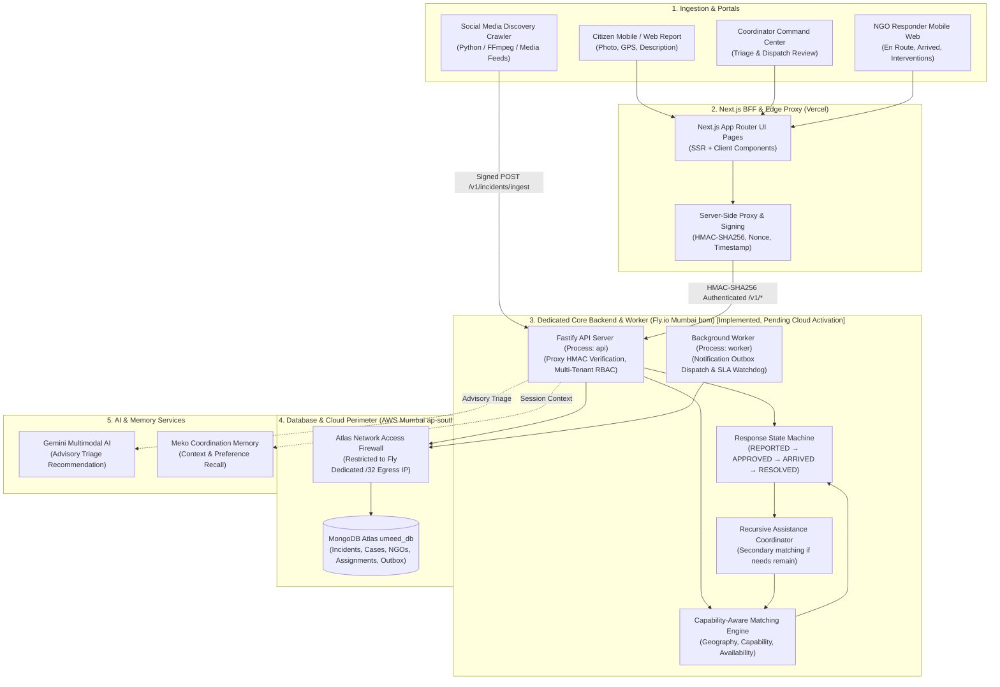
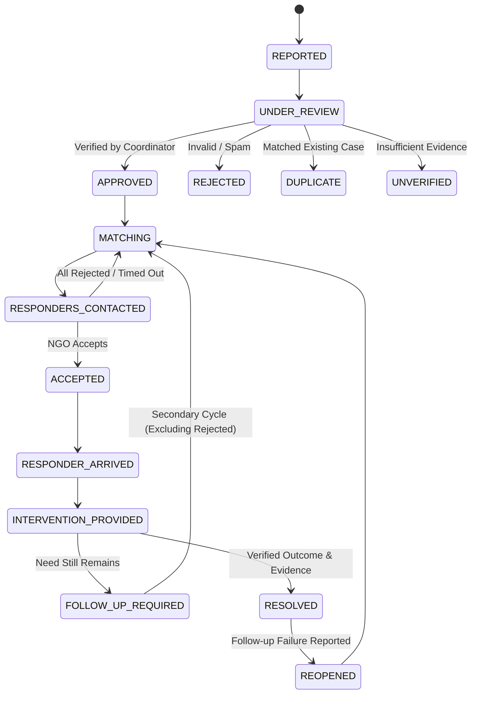

# UMEED Architecture Specification

**Project**: UMEED (HackCBS 9.0)  
**System Type**: AI-Powered Social Distress Discovery & Closed-Loop Assistance Coordination Platform  
**Target Topology**: Next.js 15 BFF (Vercel) + Dedicated Fastify Core & Worker (Fly.io Mumbai `bom` — Code Implemented, Awaiting Cloud Infrastructure Activation)

---

## 1. System Overview & Deployment Topology

UMEED is architected with a decoupled frontend/backend separation to guarantee latency resilience, multi-tenant RBAC enforcement, background asynchronous job execution, and strict static egress firewall compliance with MongoDB Atlas:

- **Frontend & BFF Layer (Workstream A — Vercel)**:
  - Built with **Next.js 15 App Router**, **React 19**, and **Tailwind CSS**.
  - Serves citizen distress reporting forms, coordinator command center, and NGO responder portals.
  - Acts as a Backend-For-Frontend (BFF), forwarding operational API requests via an HMAC-SHA256 authenticated server-side proxy (`apps/web/src/lib/proxy/backend-proxy.ts`).
- **Dedicated Operational Backend & Worker (Fly.io Mumbai `bom` — Code Implemented, Deployment Pending)**:
  - Built with **Fastify**, **TypeScript**, and **Node.js 22** (`apps/backend`).
  - Co-located in Mumbai (`bom`) adjacent to MongoDB Atlas (`ap-south-1`) to minimize database query latency.
  - Multi-process architecture defined in `fly.toml`:
    - `api`: HTTP REST API service handling distress ingestion, case lifecycle, matching, and coordination.
    - `worker`: Asynchronous background worker processing notification outbox deliveries and SLA escalation watchdogs.
  - *Infrastructure Status*: The backend service code, Dockerfile, worker, proxy, and integration tests are fully implemented in the codebase; production activation is pending Fly application creation, static egress IP allocation, and Atlas IP allowlisting.
- **Persistent Storage & Network Security**:
  - **MongoDB Atlas AWS Mumbai (`ap-south-1`)**: Stores canonical incidents, cases, NGO DARPAN registry, assignments, and audit logs.
  - **Static Egress Isolation**: Dedicated `/32` Fly egress IPv4 in Mumbai for strict Atlas firewall conformance, eliminating wildcard `0.0.0.0/0` access.
- **Discovery Crawler (Workstream B — Standalone)**:
  - Built with **Python / FastAPI**, **FFmpeg**, and multimodal models. Ingests publicly accessible media, extracts distress evidence, and pushes validated payloads to the Core Platform via shared REST schemas (`@umeed/contracts`).
- **Advisory AI & Context Memory**:
  - **Gemini 2.5 Flash**: Advisory multimodal triage recommendations (non-medical, advisory only).
  - **Meko**: Coordinator preference recall and contextual incident triage history.



---

## 2. Infrastructure Activation & Readiness State

> [!IMPORTANT]
> **Operational Distinction**: Code migration is implemented and locally validated (42 test files, 308 tests passing). Production cloud deployment is awaiting operator activation of cloud infrastructure.

| Component | Architecture Role | Implementation Status | Deployment Status |
| :--- | :--- | :--- | :--- |
| **Frontend UI & BFF** | Next.js 15 Web & Proxy | Implemented (`apps/web`) | Deployed on Vercel |
| **Fastify Core API** | Node.js 22 REST Server | Implemented (`apps/backend/src/server.ts`) | Awaiting Fly.io Launch (`bom`) |
| **Outbox & SLA Worker** | Asynchronous Task Worker | Implemented (`apps/backend/src/worker.ts`) | Awaiting Fly Process Group Spawn |
| **BFF Proxy Auth** | HMAC-SHA256 Inter-Service | Implemented (`apps/backend/src/plugins/proxy-auth.ts`) | Awaiting Shared Secret Configuration |
| **Static Egress IP** | Atlas Firewall Allowlist | Configured in `fly.toml` | Awaiting `fly ips allocate-egress` |
| **MongoDB Atlas** | Persistent Data Store | Schema & Repositories Complete | Awaiting Egress IP Whitelist Activation |

---

## 3. Canonical Ingestion Contract

All incident sources (Citizen Reporting UI and Discovery Crawler) must adhere to the versioned canonical schema:

```json
{
  "schema_version": "1.0.0",
  "source_type": "citizen_report | social_media_discovery",
  "source_reference": "unique_client_or_post_reference",
  "source_url": "https://... | null",
  "reported_at": "2026-10-31T10:30:00Z",
  "incident_type": "injured_animal | abandoned_animal | homeless_person | abandoned_elderly_person | medical_assistance | food_assistance | shelter_assistance | other",
  "subject_type": "person | animal",
  "description": "Text describing observed situation",
  "evidence": [
    {
      "type": "image | video | audio | text",
      "url": "file_or_storage_ref",
      "timestamp": "2026-10-31T10:30:00Z"
    }
  ],
  "location": {
    "latitude": 28.7041,
    "longitude": 77.1025,
    "address": "Rohini, Delhi",
    "district": "North West Delhi",
    "confidence": 0.85
  },
  "severity": {
    "level": "low | medium | high | critical | unconfirmed",
    "confidence": 0.90,
    "reasoning": ["Subject immobile near roadside", "Visible limb distress"]
  },
  "freshness": "current_confirmed_by_source | potentially_recent | old_or_reshared | unclear | unconfirmed",
  "missing_information": ["exact_landmark", "subject_current_presence"],
  "requires_human_review": true
}
```

*Idempotency Rule*: MongoDB enforces a unique compound index on `{ source_type: 1, source_reference: 1 }` to prevent duplicate ingestions.

---

## 4. Case Coordination Lifecycle State Machine

A case must never transition directly from reported to resolved without verification and proof of outcome.



---

## 5. NGO Capability-Aware Matching Engine

Instead of naive nearest-distance sorting, the engine ranks organizations using a multi-factor score:

$$\text{Score} = w_s \cdot S_{\text{capability}} + w_g \cdot S_{\text{geography}} + w_a \cdot S_{\text{availability}} + w_c \cdot S_{\text{capacity}} + w_h \cdot S_{\text{history}}$$

Where:
- $S_{\text{capability}} \in \{0, 1\}$: Hard filter. If the NGO does not handle `injured_animal`, it is immediately disqualified regardless of distance.
- $S_{\text{geography}} \in [0, 1]$: Operational district match and distance decay within service radius.
- $S_{\text{availability}}$: Operational status (`available`, `busy`, `off_duty`).
- $S_{\text{capacity}}$: Ratio of active cases to maximum concurrent capacity.
- $S_{\text{history}}$: Verified response speed and intervention completion track record.

---

## 6. Resilience & Integration Outbox

To prevent external vendor outages (Gemini, Meko) from degrading core operational coordination:
1. **Fallback Triage**: If Gemini API is unreachable, incidents transition to `UNDER_REVIEW` with an `AI_UNAVAILABLE` flag for direct human triage.
2. **Durable Operational Telemetry**: Assistance events (`incident_created`, `case_resolved`, etc.) are captured transactionally within the operational database for internal reporting and metrics without external lakehouse dependency.
3. **Meko Memory Isolation**: Meko memory operations run server-side with fail-soft boundaries. If the Meko MCP server is unavailable, the coordinator interface falls back to standard rule-based recommendations.

---

## 7. Ethical Non-Negotiables & Security Guardrails

- **No Autonomous Dispatch**: AI outputs structured triage suggestions; an authorized coordinator must confirm action for high-risk incidents.
- **No Autonomous Medical Diagnosis**: AI identifies visible conditions and potential assistance types, explicitly flagged as non-medical observations.
- **Beneficiary Privacy**: No facial recognition, biometric analysis, or unredacted PII is exported to analytics or public stores.
- **Server-Side Secret Isolation**: All keys (`GEMINI_API_KEY`, `MONGODB_URI`, `MEKO_API_KEY`) are restricted to Node.js server runtime and never shipped to client bundles.

