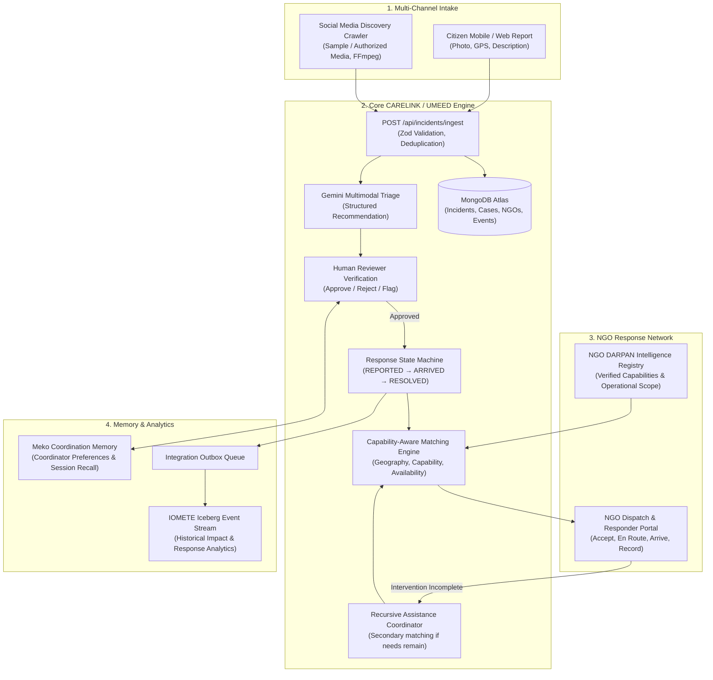
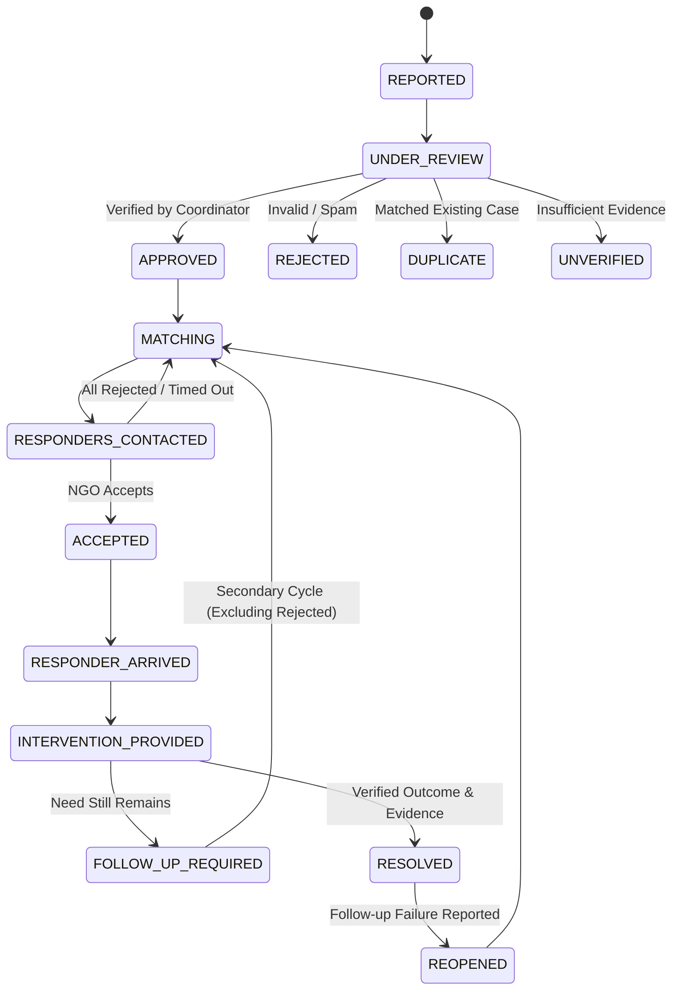

# UMEED Architecture Specification

**Project**: UMEED (HackCBS 9.0)  
**System Type**: AI-Powered Social Distress Discovery & Closed-Loop Assistance Coordination Platform

---

## 1. System Overview

UMEED is designed with a strict separation of concerns to guarantee resilience:
- **Core Platform (Workstream A)**: Built on **Next.js App Router**, **TypeScript**, **Tailwind CSS**, and **MongoDB Atlas**. Manages citizen reports, human triage verification, NGO intelligence, capability-aware geospatial matching, multi-responder coordination, and recursive follow-up loops.
- **Discovery Crawler (Workstream B - Optional / Independent)**: Built with **Python / FastAPI**, **FFmpeg**, and multimodal models. Ingests publicly accessible and authorized media, extracts distress evidence, and pushes validated payloads to the Core Platform via a shared REST contract.
- **External Integrations**:
  - **Gemini (Multimodal)**: Structured incident extraction and triage recommendation.
  - **Meko**: Persistent coordination memory and coordinator preference recall.
  - **IOMETE**: Durable historical impact analytics powered by an asynchronous Integration Outbox.



---

## 2. Canonical Ingestion Contract

All incident sources (Citizen Reporting UI and Discovery Crawler) must adhere to the versioned canonical schema:

```json
{
  "schema_version": "1.0.0",
  "source_type": "citizen_report | social_media_discovery",
  "source_reference": "unique_client_or_post_reference",
  "source_url": "https://... | null",
  "reported_at": "2026-10-31T10:30:00Z",
  "incident_type": "injured_animal | abandoned_animal | homeless_person | abandoned_elderly_person | medical_assistance | food_assistance | shelter_assistance | other",
  "subject_type": "person | animal",
  "description": "Text describing observed situation",
  "evidence": [
    {
      "type": "image | video | audio | text",
      "url": "file_or_storage_ref",
      "timestamp": "2026-10-31T10:30:00Z"
    }
  ],
  "location": {
    "latitude": 28.7041,
    "longitude": 77.1025,
    "address": "Rohini, Delhi",
    "district": "North West Delhi",
    "confidence": 0.85
  },
  "severity": {
    "level": "low | medium | high | critical | unconfirmed",
    "confidence": 0.90,
    "reasoning": ["Subject immobile near roadside", "Visible limb distress"]
  },
  "freshness": "current_confirmed_by_source | potentially_recent | old_or_reshared | unclear | unconfirmed",
  "missing_information": ["exact_landmark", "subject_current_presence"],
  "requires_human_review": true
}
```

*Idempotency Rule*: MongoDB enforces a unique compound index on `{ source_type: 1, source_reference: 1 }` to prevent duplicate ingestions.

---

## 3. Case Coordination Lifecycle State Machine

A case must never transition directly from reported to resolved without verification and proof of outcome.



---

## 4. NGO Capability-Aware Matching Engine

Instead of naive nearest-distance sorting, the engine ranks organizations using a multi-factor score:

$$\text{Score} = w_s \cdot S_{\text{capability}} + w_g \cdot S_{\text{geography}} + w_a \cdot S_{\text{availability}} + w_c \cdot S_{\text{capacity}} + w_h \cdot S_{\text{history}}$$

Where:
- $S_{\text{capability}} \in \{0, 1\}$: Hard filter. If the NGO does not handle `injured_animal`, it is immediately disqualified regardless of distance.
- $S_{\text{geography}} \in [0, 1]$: Operational district match and distance decay within service radius.
- $S_{\text{availability}}$: Operational status (`available`, `busy`, `off_duty`).
- $S_{\text{capacity}}$: Ratio of active cases to maximum concurrent capacity.
- $S_{\text{history}}$: Verified response speed and intervention completion track record.

---

## 5. Resilience & Integration Outbox

To prevent external vendor outages (IOMETE, Gemini, Meko) from degrading core operational coordination:
1. **Fallback Triage**: If Gemini API is unreachable, incidents transition to `UNDER_REVIEW` with an `AI_UNAVAILABLE` flag for direct human triage.
2. **Durable Outbox for Analytics**: Events (`incident_created`, `case_resolved`, etc.) are written in MongoDB transactionally within `integration_outbox`. A background worker pushes batches to IOMETE with exponential backoff.
3. **Meko Memory Isolation**: Meko memory operations run server-side with fail-soft boundaries. If the Meko MCP server is unavailable, the coordinator interface falls back to standard rule-based recommendations.

---

## 6. Ethical Non-Negotiables & Security Guardrails

- **No Autonomous Dispatch**: AI outputs structured triage suggestions; an authorized coordinator must confirm action for high-risk incidents.
- **No Autonomous Medical Diagnosis**: AI identifies visible conditions and potential assistance types, explicitly flagged as non-medical observations.
- **Beneficiary Privacy**: No facial recognition, biometric analysis, or unredacted PII is exported to analytics or public stores.
- **Server-Side Secret Isolation**: All keys (`GEMINI_API_KEY`, `MONGODB_URI`, `MEKO_API_KEY`, `IOMETE_TOKEN`) are restricted to Node.js server runtime and never shipped to client bundles.

