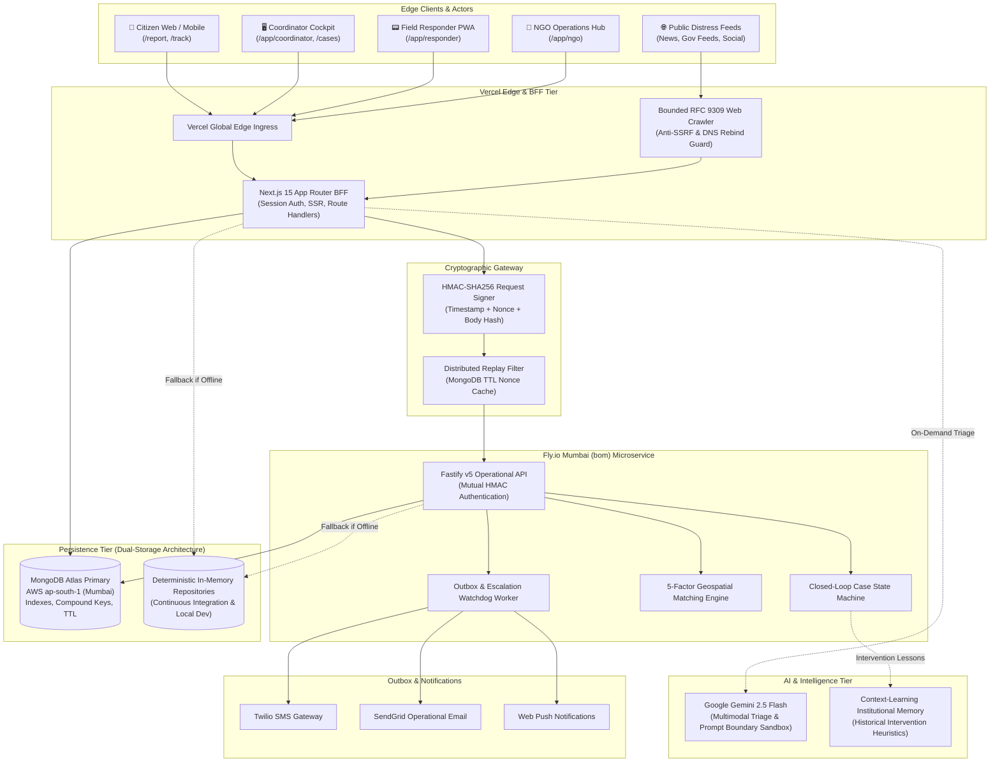
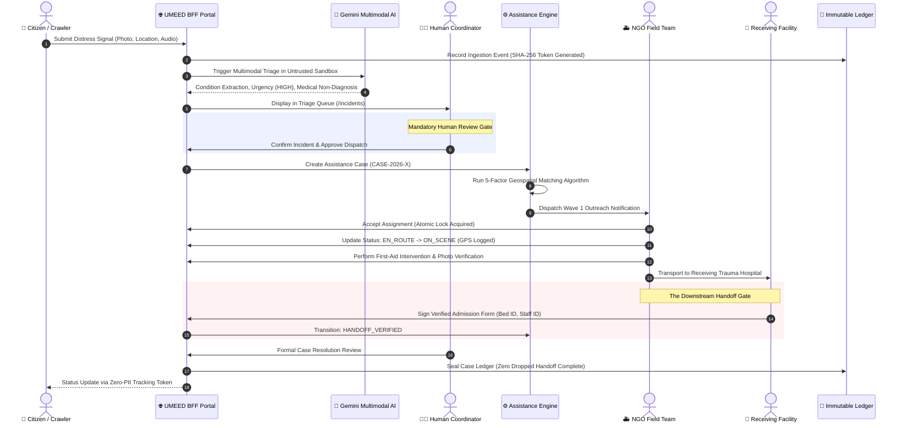
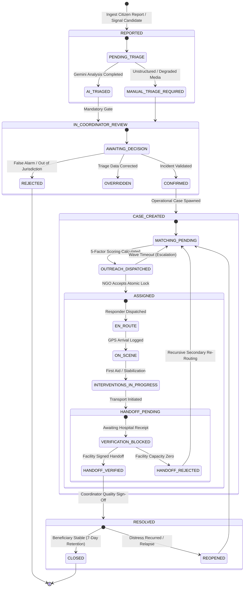
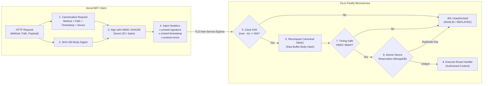

# UMEED (उम्मीद / CareLink)

<div align="center">

```
  ███████╗   ███╗   ███╗  ███████╗  ███████╗  ██████╗ 
  ██╔════╝   ████╗ ████║  ██╔════╝  ██╔════╝  ██╔══██╗
  ██║  ███╗  ██╔████╔██║  █████╗    █████╗    ██║  ██║
  ██║   ██║  ██║╚██╔╝██║  ██╔══╝    ██╔══╝    ██║  ██║
  ╚██████╔╝  ██║ ╚═╝ ██║  ███████╗  ███████╗  ██████╔╝
   ╚═════╝   ╚═╝     ╚═╝  ╚══════╝  ╚══════╝  ╚═════╝ 
```

**Next-Generation Autonomous Social Distress Discovery & Closed-Loop Humanitarian Assistance Coordination Platform**

*Every distress signal deserves an immediate response. Every response demands a verified handoff.*

[](packages/contracts)
[-3178c6?style=for-the-badge&logo=typescript&logoColor=white)](tsconfig.json)
[](apps/web)
[](apps/backend)
[](apps/web/src/lib/db)
[](ARCHITECTURE.md)
[](LICENSE)

---

### [Live Platform](https://umeed-platform-nu.vercel.app) • [Architectural Docs](docs/UMEED_TARGET_ARCHITECTURE.md) • [State Machine Spec](docs/UMEED_CASE_STATE_MACHINE.md) • [Security Model](docs/UMEED_SECURITY_THREAT_MODEL.md) • [API Contracts](docs/UMEED_API_CONTRACTS.md)

</div>

---

## 📑 Table of Contents

1. [Executive Summary & Problem Statement](#1-executive-summary--problem-statement)
2. [The Core Guarantee: Zero Dropped Handoffs](#2-the-core-guarantee-zero-dropped-handoffs)
3. [Enterprise Architecture & System Topography](#3-enterprise-architecture--system-topography)
   - [High-Level Topology (Mermaid)](#high-level-topology)
   - [End-to-End Operational Lifecycle Sequence (Mermaid)](#end-to-end-operational-lifecycle-sequence)
   - [Incident & Case Finite State Machine (Mermaid)](#incident--case-finite-state-machine)
   - [Inter-Service Security & Replay Prevention Gateway (Mermaid)](#inter-service-security--replay-prevention-gateway)
4. [Software Engineering & SOLID Principles in Practice](#4-software-engineering--solid-principles-in-practice)
5. [Feature Catalog & Operational Portals](#5-feature-catalog--operational-portals)
6. [Explainable 5-Factor NGO Matching Algorithm](#6-explainable-5-factor-ngo-matching-algorithm)
7. [Enterprise Multi-Tenancy & RBAC Matrix](#7-enterprise-multi-tenancy--rbac-matrix)
8. [Monorepo Directory Structure](#8-monorepo-directory-structure)
9. [Developer Quickstart & Local Setup](#9-developer-quickstart--local-setup)
10. [Automated Test Suite & Verification](#10-automated-test-suite--verification)
11. [Environment Variables Specification](#11-environment-variables-specification)
12. [Cloud Infrastructure & Production Cutover](#12-cloud-infrastructure--production-cutover)
13. [Ethical AI Governance & Safeguards](#13-ethical-ai-governance--safeguards)
14. [Open Source Contribution Guidelines](#14-open-source-contribution-guidelines)
15. [License & Acknowledgements](#15-license--acknowledgements)

---

## 1. Executive Summary & Problem Statement

In humanitarian relief, disaster management, and social emergency interventions across metropolitan hubs like Delhi NCR, modern emergency reporting systems suffer from a fatal structural flaw: **The Unverified Drop-Off Crisis**.

Conventional crisis apps celebrate the moment an ambulance or rescue van picks up a vulnerable citizen or abandoned animal. However, real-world field operations reveal a systemic breakdown:
- If a trauma center is at critical capacity, the patient is left unadmitted at the facility gates.
- If a nighttime winter shelter lacks medical nursing staff, hypothermia patients are refused entry with no alternative routing.
- If an NGO only administers basic first-aid, secondary needs (e.g., orthopedic surgery, psychological counseling, permanent shelter) are lost in bureaucratic silos.

**UMEED** (*Hope* / *CareLink*) re-engineers humanitarian logistics from the ground up as a **fault-tolerant, closed-loop assistance coordination engine**. By unifying autonomous public distress discovery, privacy-preserving citizen reporting, human-verified multimodal AI triage, and cryptographically verified facility handoffs, UMEED guarantees that **no beneficiary is ever abandoned between dispatch and institutional admission**.

---

## 2. The Core Guarantee: Zero Dropped Handoffs

```text
[ SIGNAL DISCOVERY ]  ──►  [ MULTIMODAL TRIAGE ]  ──►  [ COORDINATOR GATE ]
         ▲                                                     │
         │ (Recursive Loop)                                    ▼
[ REOPEN / ESCALATE ] ◄── [ CASE RESOLUTION ]   ◄─── [ VERIFIED HANDOFF ]
                                                       ▲
                                                       │ (Gate Closed Until Verified)
                                                 [ RECEIVING FACILITY ]
```

UMEED enforces an uncompromised operational invariant:

> **The Downstream Verified Handoff Invariant**:  
> A field responder cannot mark an incident resolved simply by arriving at a clinic, shelter, or hospital. Case closure is **strictly blocked** by the state engine until authorized personnel at the receiving facility generate and sign a verifiable admission receipt (`HANDOFF_VERIFIED`). If admission cannot be completed, secondary matching waves and emergency re-routing are triggered automatically.

---

## 3. Enterprise Architecture & System Topography

UMEED is architected as a decoupled, multi-tier distributed system combining a **Next.js 15 Backend-for-Frontend (BFF)** with a high-throughput **Fastify Node.js Microservice**, backed by **MongoDB Atlas** and **Google Gemini Multimodal AI**.

### High-Level Topology



---

### End-to-End Operational Lifecycle Sequence



---

### Incident & Case Finite State Machine



---

### Inter-Service Security & Replay Prevention Gateway



---

## 4. Software Engineering & SOLID Principles in Practice

UMEED is crafted adhering to **Clean Architecture** and **Domain-Driven Design (DDD)**. Below is how each **SOLID** principle is directly embedded across the codebase:

### 1. Single Responsibility Principle (SRP)
Every class, service, and module possesses exactly one reason to change:
- [`apps/web/src/features/matching/services/matching.service.ts`](apps/web/src/features/matching/services/matching.service.ts): Exclusively computes multi-factor candidate scoring and ranked weights. It does not touch database connections or dispatch emails.
- [`apps/web/src/lib/ai/gemini/triage.service.ts`](apps/web/src/lib/ai/gemini/triage.service.ts): Handles raw prompt isolation, multimodal schema validation, and fallback parsing. It never makes operational dispatch decisions.
- [`apps/backend/src/plugins/proxy-auth.ts`](apps/backend/src/plugins/proxy-auth.ts): Solely responsible for cryptographic HMAC canonicalization, timing-safe evaluation, and replay-cache reservations.

### 2. Open/Closed Principle (OCP)
Core subsystems are open for extension but closed for modification:
- **Pluggable Notification System** (`apps/web/src/features/notifications/adapters/`): New dispatch channels (WhatsApp, Signal, Telegram) can be added simply by implementing the [`NotificationAdapter`](apps/web/src/features/notifications/types.ts) interface without altering existing delivery logic.
- **Triage Pipeline & Prompt Architecture**: The multimodal evaluation pipeline supports versioned model swaps (e.g., from Gemini 1.5 to 2.5 Flash) via pluggable prompt decorators without touching ingestion route handlers.

### 3. Liskov Substitution Principle (LSP)
All repository implementations are completely interchangeable without breaking contract invariants:
- [`apps/web/src/features/incidents/repositories/index.ts`](apps/web/src/features/incidents/repositories/index.ts): The system dynamically swaps between `MongoIncidentRepository` and `InMemoryIncidentRepository`. High-fidelity unit and integration test suites run against both layers interchangeably with zero code branching or behavior alterations.

### 4. Interface Segregation Principle (ISP)
Clients never depend on interfaces they do not consume:
- Contract packages in [`packages/contracts/src/`](packages/contracts/src/) isolate schemas into focused interfaces:
  - `IncidentIngestSchema` (public citizen intake fields)
  - `CoordinatorReviewSchema` (internal verification actions)
  - `ResponderActionSchema` (mobile field arrival and telemetry)
  - `FacilityHandoffSchema` (hospital bed and credential receipts)

### 5. Dependency Inversion Principle (DIP)
High-level operational use cases depend upon abstractions, never concrete drivers:
- Core controllers and services (`CaseService`, `FacilityService`, `AuthService`) receive repository interfaces through constructor dependency injection and factory providers (`getIncidentRepository()`, `getFacilityRepository()`), decoupling domain workflows from database engines.

---

## 5. Feature Catalog & Operational Portals

| Workspace & Route | Target Actor | Key Operational Capabilities | Security & Privacy Guarantees |
| :--- | :--- | :--- | :--- |
| **Citizen Intake**<br>`/report` | Anonymous Citizens | Touch-friendly photo upload, geo-pinning, speech-to-text distress description, multi-category selection. | Beneficiary phone/email scrubbed with SHA-256 tokens; zero external PII storage. |
| **Citizen Tracking**<br>`/track` | Citizens | Real-time status tracker (Triaged, Responder Dispatched, Hospital Handoff Verified). | Requires cryptographic token from intake; does not expose NGO personal responder info. |
| **Distress Radar**<br>`/discovery` | Coordinators | MapLibre GL geospatial map, RFC 9309 crawler monitor, candidate triage drawer. | Centroid coordinate coarsening (~1.1 km jitter); anti-SSRF IP filtering. |
| **Coordinator Console**<br>`/app/coordinator` | Lead Coordinators | AI triage review, manual overrides, 5-factor NGO match inspector, manual re-routing. | Human-in-the-loop guarantee; mandatory sign-off before dispatch waves fire. |
| **Mission Control**<br>`/cases` | Operations Staff | Case lifecycle state machine, escalation watchdog, secondary assistance cycles. | Strict audit log tracking every status mutation and coordinator ID. |
| **Field Cockpit**<br>`/app/responder` | NGO Responders | Mobile-first UI: Accept task, navigate, log GPS arrival, submit intervention photos. | Atomic task claiming prevents dual-responder race conditions. |
| **Downstream Gate**<br>`/app/facilities` | Hospitals / Shelters | Receiving facility admission receipt generator, bed allocation, verified digital sign-off. | Case resolution strictly blocked without counter-signed facility token. |
| **NGO Operations Hub**<br>`/app/ngo` | NGO Leadership | Fleet capacity management, team roster, jurisdiction boundary mapping, credentials. | Multi-tenant tenant ID filtering enforced at repository layer. |
| **Platform Admin**<br>`/app/admin` | System Admins | NGO accreditation verification, facility registry, HMAC key management, diagnostics. | Restricted to `SUPERADMIN` RBAC role with immutable access audit trail. |
| **Impact Analytics**<br>`/analytics` | Public / Donors | Real-time resolution rates, average response time, district distress distribution. | K-anonymity privacy protection; zero individual incident data exposed. |

---

## 6. Explainable 5-Factor NGO Matching Algorithm

When an incident is approved for dispatch, UMEED's matching engine evaluates all accredited NGOs across Delhi NCR using a multi-factor weighted scoring model:

$$\text{MatchScore} = w_1 S_{\text{capability}} + w_2 S_{\text{distance}} + w_3 S_{\text{capacity}} + w_4 S_{\text{jurisdiction}} + w_5 S_{\text{availability}}$$

Where:
1. **Capability Alignment ($w_1 = 0.35$)**: Hard requirement filter checking certified services (e.g., `ANIMAL_TRAUMA_CARE`, `PEDIATRIC_EMERGENCY`, `SHELTER_NURSING`). Mismatched NGOs receive a score of $0$ and are disqualified immediately.
2. **Geospatial Distance ($w_2 = 0.25$)**: Calculated using the Haversine great-circle formula between the incident coordinates and NGO base station:
   $$d = 2R \arcsin \left( \sqrt{\sin^2\left(\frac{\Delta \phi}{2}\right) + \cos \phi_1 \cos \phi_2 \sin^2\left(\frac{\Delta \lambda}{2}\right)} \right)$$
   Normalized inverse distance score favoring responders within a $15\text{ km}$ radius.
3. **Verified Live Capacity ($w_3 = 0.20$)**: Evaluates available ambulance fleet, active field personnel, and current open case load to prevent operational burnout.
4. **District Jurisdiction ($w_4 = 0.10$)**: Evaluates statutory operational permits across Delhi's 11 revenue districts (e.g., South West Delhi, Central Delhi).
5. **Historical Availability & Response Speed ($w_5 = 0.10$)**: Rates average time-to-arrival and acceptance rate over the trailing 30 days.

---

## 7. Enterprise Multi-Tenancy & RBAC Matrix

UMEED enforces strict server-side Role-Based Access Control (RBAC) across all API routes and UI views:

| Role | Citizen Reporting | Incident Review | Case Dispatch | Field Actions | Facility Handoff | NGO Admin | System Admin |
| :--- | :---: | :---: | :---: | :---: | :---: | :---: | :---: |
| `CITIZEN` | ✅ | ❌ | ❌ | ❌ | ❌ | ❌ | ❌ |
| `FIELD_RESPONDER` | ❌ | ❌ | ❌ | ✅ | ✅ | ❌ | ❌ |
| `COORDINATOR` | ❌ | ✅ | ✅ | ❌ | ❌ | ❌ | ❌ |
| `NGO_ADMIN` | ❌ | ❌ | ❌ | ✅ | ❌ | ✅ | ❌ |
| `SUPERADMIN` | ✅ | ✅ | ✅ | ✅ | ✅ | ✅ | ✅ |

- **Session Hardening**: Cryptographically signed `umeed_session` HttpOnly, SameSite=Lax cookie.
- **Tenant Isolation**: Every database query touching organization-specific data applies a mandatory tenant filter `{ organizationId: session.orgId }`.

---

## 8. Monorepo Directory Structure

```text
umeed/
├── apps/
│   ├── web/                          # Next.js 15 App Router Frontend & BFF
│   │   ├── src/
│   │   │   ├── app/                  # Application routes, portals, and API endpoints
│   │   │   │   ├── (public)/         # Citizen intake (/report) and tracking (/track)
│   │   │   │   ├── app/              # Authenticated workspace consoles
│   │   │   │   │   ├── admin/        # System diagnostics & NGO accreditation
│   │   │   │   │   ├── coordinator/  # Incident triage and mission control
│   │   │   │   │   ├── ngo/          # NGO capacity, team, and request hub
│   │   │   │   │   └── responder/    # Touch-friendly field responder cockpit
│   │   │   │   └── api/              # Secure REST API endpoints
│   │   │   ├── features/             # Domain modules adhering to SOLID principles
│   │   │   │   ├── assistance-engine/# Outreach, state transitions, outbox
│   │   │   │   ├── auth/             # Session management, users, and RBAC
│   │   │   │   ├── cases/            # Operational case lifecycle & dispatch
│   │   │   │   ├── discovery/        # Public signal crawler & candidate radar
│   │   │   │   ├── facilities/       # Hospital and shelter handoff registry
│   │   │   │   ├── incidents/        # Ingestion, deduplication, triage
│   │   │   │   ├── matching/         # 5-factor scoring engine
│   │   │   │   ├── ngos/             # Organization profile & verification
│   │   │   │   └── notifications/    # Pluggable multi-channel outbox
│   │   │   ├── components/           # Reusable Tailwind UI components & layouts
│   │   │   └── lib/                  # Shared database, AI, security utilities
│   │   ├── Dockerfile                # Production Next.js container configuration
│   │   └── package.json
│   │
│   └── backend/                      # High-Performance Fastify Operational Microservice
│       ├── src/
│       │   ├── config/               # Zod-validated environment schema
│       │   ├── health/               # High-availability liveness & readiness probes
│       │   ├── modules/              # Fastify feature route modules
│       │   │   ├── admin/            # Platform diagnostics & health checks
│       │   │   ├── assistance/       # Assignment execution & lifecycle
│       │   │   ├── auth/             # Inter-service session verification
│       │   │   ├── cases/            # Core case management
│       │   │   ├── discovery/        # Candidate review & ingestion
│       │   │   ├── facilities/       # Handoff registry routes
│       │   │   ├── incidents/        # Incident endpoints
│       │   │   ├── ngos/             # NGO directory & capacity
│       │   │   ├── notifications/    # Outbox processor
│       │   │   └── responders/       # Field action routes
│       │   ├── plugins/              # Database & HMAC proxy authentication
│       │   ├── app.ts                # Fastify application factory
│       │   ├── server.ts             # Microservice HTTP listener
│       │   └── worker.ts             # Background escalation & outbox processor
│       ├── Dockerfile                # Fly.io production microservice container
│       └── package.json
│
├── packages/
│   └── contracts/                    # Canonical Schemas & Zod v4 Contracts
│       ├── src/
│       │   ├── auth.ts               # User, session, and RBAC contracts
│       │   ├── case.ts               # Case lifecycle, assignment, and handoff contracts
│       │   ├── discovery.ts          # Public crawler and candidate schemas
│       │   ├── engine.ts             # Matching parameters and outbox schemas
│       │   ├── entities.ts           # Shared domain entities
│       │   ├── incident.ts           # Incident intake, triage, and duplicate schemas
│       │   └── ngo.ts                # Organization profile & capacity contracts
│       └── package.json
│
├── data/                             # Seed Data & Facility Fixtures
│   ├── registry/                     # Verified Government Datasets
│   └── seeds/                        # Real Delhi Hospitals, Night Shelters, & NGOs
│
├── docs/                             # Engineering Architecture & Audit Runbooks
│   ├── UMEED_TARGET_ARCHITECTURE.md  # Comprehensive Architectural Blueprint
│   ├── UMEED_CASE_STATE_MACHINE.md   # State Machine Transitions & Invariants
│   ├── UMEED_SECURITY_THREAT_MODEL.md# Threat Vectors & Mitigation Protocols
│   └── UMEED_API_CONTRACTS.md        # Complete OpenAPI / Contract Specification
│
├── fly.toml                          # Fly.io Microservice Deployment Manifest
├── vercel.json                       # Vercel Deployment & Route Proxy Configuration
└── package.json                      # Monorepo Workspace Configuration
```

---

## 9. Developer Quickstart & Local Setup

### Prerequisites
- **Node.js**: `>= 20.9.0` (LTS recommended)
- **npm**: `>= 10.0.0`
- **Docker**: (Optional, for containerized local execution)

### 1. Clone & Install Dependencies
```bash
# Clone the repository
git clone https://github.com/suvendukungfu/UMEED.git
cd UMEED

# Install dependencies across all monorepo workspaces
npm install
```

### 2. Configure Environment Variables
Copy the sample environment configuration:
```bash
cp .env.example apps/web/.env.local
cp apps/backend/.env.example apps/backend/.env.local
```
*(See [Environment Variables Specification](#11-environment-variables-specification) for configuration keys).*

### 3. Seed Local Demo Data
Seed realistic Delhi NCR trauma centers, night shelters, and accredited NGOs:
```bash
npm run seed:demo
```

### 4. Launch Development Environment
```bash
# Launch the Next.js Web Platform (default port: 3000)
npm run dev:umeed

# Or run the Fastify Backend Microservice in parallel (default port: 8080)
npm run dev --workspace=apps/backend
```

Navigate to:
- **Landing Page**: [http://localhost:3000](http://localhost:3000)
- **Citizen Report**: [http://localhost:3000/report](http://localhost:3000/report)
- **Public Signal Radar**: [http://localhost:3000/discovery](http://localhost:3000/discovery)
- **Coordinator Workspace**: [http://localhost:3000/app/coordinator](http://localhost:3000/app/coordinator)
- **Field Responder Cockpit**: [http://localhost:3000/app/responder](http://localhost:3000/app/responder)
- **Backend Health Check**: [http://localhost:8080/health](http://localhost:8080/health)

---

## 10. Automated Test Suite & Verification

The UMEED test suite exercises **308 tests across 42 test suites** spanning contract validation, state machine integrity, HMAC security, repository duality, and AI triage sandboxing.

```bash
# Run the complete test suite across all monorepo workspaces
npm test

# Run strict TypeScript compilation check (0 errors required)
npm run typecheck:umeed

# Run workspace linter
npm run lint:umeed

# Compile optimized production builds
npm run build:umeed
```

### Test Verification Breakdown
- **`packages/contracts`**: 19 tests validating strict schema enforcement, boundary serialization, and Zod v4 schemas.
- **`apps/backend`**: 14 tests validating mutual HMAC proxy signatures, distributed replay protection, and route parity.
- **`apps/web`**: 275 tests verifying 5-factor NGO matching, case state machine transitions, recursive assistance loops, and dual-repository persistence.

---

## 11. Environment Variables Specification

| Key | Workspace | Required in Prod | Description | Default / Example |
| :--- | :---: | :---: | :--- | :--- |
| `NODE_ENV` | All | Yes | Operational runtime mode (`development`, `test`, `production`). | `development` |
| `PORT` | Backend | No | HTTP listening port for Fastify microservice. | `8080` |
| `FLY_REGION` | Backend | No | Primary deployment region tag for health reporting. | `bom` (Mumbai) |
| `MONGODB_URI` | Both | Yes | Primary MongoDB Atlas connection string. | `mongodb+srv://...` |
| `MONGODB_DB` | Both | Yes | Target database namespace. | `umeed_db` |
| `UMEED_PROXY_SIGNING_SECRET` | Both | Yes | 32+ char secret for inter-service HMAC-SHA256 signing. | `hex-encoded-secret` |
| `UMEED_BACKEND_URL` | Web | Yes | Private or public URL to the Fastify microservice on Fly.io. | `https://umeed-backend.fly.dev` |
| `GEMINI_API_KEY` | Both | Yes | Google Gemini API key for multimodal condition extraction. | `AIzaSy...` |
| `COORDINATOR_API_KEY` | Both | No | Static bearer secret for automated coordinator webhooks. | `coord-secret-...` |
| `CRAWLER_API_KEY` | Both | No | Dedicated credential for external feed crawler ingestion. | `crawl-secret-...` |

---

## 12. Cloud Infrastructure & Production Cutover

UMEED utilizes a **dual-cloud enterprise topography** designed for maximum uptime, zero-trust perimeter defense, and sub-millisecond database queries:

```
┌─────────────────────────────────┐        ┌─────────────────────────────────┐
│        VERCEL SERVERLESS        │        │         FLY.IO (MUMBAI)         │
│  - Next.js 15 App Router BFF    │  HMAC  │  - Fastify v5 Operational Node  │
│  - Global Edge CDN Ingress      ├───────►│  - Background Escalation Worker│
│  - Static Asset Optimization    │ (TLS)  │  - Static Outbound IPv4 / IPv6  │
└─────────────────────────────────┘        └────────────────┬────────────────┘
                                                            │
                                                   Dedicated│VPC / Whitelist
                                                            ▼
                                           ┌─────────────────────────────────┐
                                           │       MONGODB ATLAS (AWS)       │
                                           │  - Region: ap-south-1 (Mumbai)  │
                                           │  - M0/M10 Persistent Storage    │
                                           │  - Compound Indexes & TTL Caches│
                                           └─────────────────────────────────┘
```

1. **Vercel Edge (Next.js 15)**: Hosts citizen forms, coordinator dashboards, and edge API proxies. All inter-service calls to Fly.io are signed with HMAC-SHA256 headers.
2. **Fly.io Microservice (`fly.toml`)**: Deployed in the Mumbai (`bom`) region on dedicated VMs with static IPv4 and IPv6 egress IPs.
3. **MongoDB Atlas (AWS `ap-south-1`)**: Shared persistent storage. Network Access rules whitelist the static Fly.io egress IPs.
4. **Automated Cutover Runbook**: Detailed in [`docs/UMEED_PRODUCTION_CUTOVER.md`](docs/UMEED_PRODUCTION_CUTOVER.md).

---

## 13. Ethical AI Governance & Safeguards

UMEED uses AI strictly to augment and accelerate humanitarian coordination, never to replace human accountability:

1. **Non-Autonomous Dispatch**: AI models never trigger field responder dispatch directly. Every assistance deployment requires explicit review from an accredited human coordinator.
2. **Observational vs Diagnostic**: Gemini models are strictly prompted to extract visible observations (e.g., *"Subject displays laceration on left limb; mobility restricted"*). Autonomous medical diagnoses or pharmaceutical recommendations are strictly forbidden.
3. **Beneficiary Privacy Preservation**: Contact phone numbers and email addresses are hashed and scrubbed before incident telemetry reaches external LLM inference endpoints.
4. **Prompt Injection Sandboxing**: All user-submitted text and crawler data are strictly isolated inside delimiter fences (`<<<UNTRUSTED_CITIZEN_SUBMISSION>>>`) to prevent prompt manipulation.

---

## 14. Open Source Contribution Guidelines

We welcome contributions from open-source developers, humanitarian tech volunteers, and security researchers!

### Contribution Workflow
1. **Fork the Repository**: Create a personal fork on GitHub.
2. **Create a Feature Branch**:
   ```bash
   git checkout -b feat/your-feature-name
   ```
3. **Commit Conventional Commits**:
   Follow the [Conventional Commits](https://www.conventionalcommits.org/) specification:
   - `feat(matching)`: Add capability weight normalization
   - `fix(handoff)`: Prevent unverified hospital case closure
   - `test(backend)`: Add HMAC clock-drift test cases
   - `docs(readme)`: Update architecture diagrams
4. **Verify Quality Gates**:
   Ensure all checks pass before pushing:
   ```bash
   npm test
   npm run typecheck:umeed
   npm run lint:umeed
   ```
5. **Submit a Pull Request**: Detail your changes, test evidence, and related issue numbers.

Please review our [Contributing Guide](CONTRIBUTING.md) and [Code of Conduct](CODE_OF_CONDUCT.md).

---

## 15. License & Acknowledgements

This project is licensed under the **MIT License** — see the [LICENSE](LICENSE) file for details.

### Acknowledgements & Citations
- Built for **HackCBS 9.0 | Meko Challenge Track A**.
- **Delhi Revenue Department & Municipal Corporation of Delhi (MCD)**: Open government geographic data standards.
- **Open Government Data (OGD) Platform India (`data.gov.in`)**: Facility datasets.
- **MapLibre GL**: Open-source geospatial visualization.
- **Google DeepMind**: Gemini 2.5 Flash developer tier API.

<div align="center">

**UMEED (उम्मीद)** — *Because in moments of distress, hope must be backed by engineering.*

Made with ❤️ by the UMEED Open Source Team

</div>
