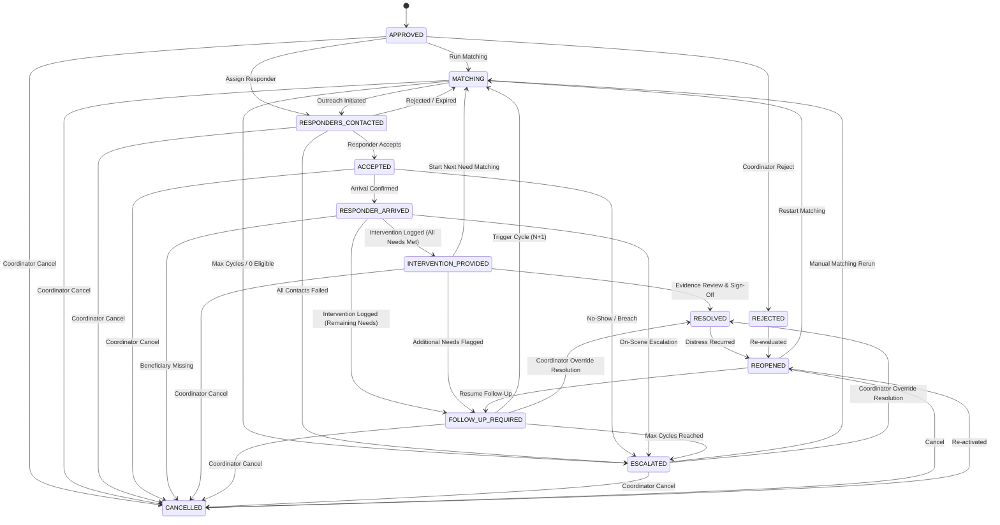

# UMEED Case Lifecycle & State Transition Model

## 1. Executive Overview

The UMEED Case Lifecycle governs the progression of distress assistance from initial human coordinator verification through multi-organisation response dispatch, field arrival, intervention provision, recursive follow-up cycles, and verified evidence-backed resolution.

Central Architectural Invariant:
**An incident never automatically creates an assistance case, and an assistance case never automatically resolves.** Human coordinators retain ultimate dispatch and resolution authority.

---

## 2. Canonical Case States

A case transitions through 12 deterministic states:

| Status | Category | Description |
| --- | --- | --- |
| `APPROVED` | Initial | Created from an approved incident. Ready for matching or responder dispatch. |
| `MATCHING` | Active | Recommendation engine evaluating eligible organisations for active requirements. |
| `RESPONDERS_CONTACTED` | Active | Outreach initiated to one or more primary responders. |
| `ACCEPTED` | Active | Primary organisation accepted response duty for one or more needs. |
| `RESPONDER_ARRIVED` | Active | On-scene arrival verified by assigned responder. |
| `INTERVENTION_PROVIDED` | Active | Immediate emergency assistance delivered and logged with evidence. |
| `FOLLOW_UP_REQUIRED` | Active | Intervention revealed unfulfilled or secondary needs requiring further matching. |
| `ESCALATED` | Review | Matching exhausted, deadline lapsed, or zero eligible NGOs available. |
| `RESOLVED` | Terminal | Assistance requirements fulfilled with verified evidence and coordinator review. |
| `CANCELLED` | Terminal | Case cancelled due to beneficiary departure, prior resolution, or retraction. |
| `REJECTED` | Terminal | Case closed without assistance following audit or duplicate determination. |
| `REOPENED` | Active | Previously closed/cancelled case re-activated due to recurring distress. |

---

## 3. Allowed Case State Transitions



---

## 4. State Transition Matrix & Invariants

```typescript
export const CASE_TRANSITIONS: Record<CaseStatus, CaseStatus[]> = {
  APPROVED: ["MATCHING", "RESPONDERS_CONTACTED", "ACCEPTED", "CANCELLED", "REJECTED"],
  MATCHING: ["RESPONDERS_CONTACTED", "ESCALATED", "CANCELLED"],
  RESPONDERS_CONTACTED: ["ACCEPTED", "MATCHING", "ESCALATED", "CANCELLED"],
  ACCEPTED: ["RESPONDER_ARRIVED", "CANCELLED", "ESCALATED"],
  RESPONDER_ARRIVED: [
    "INTERVENTION_PROVIDED",
    "FOLLOW_UP_REQUIRED",
    "CANCELLED",
    "ESCALATED",
    "RESOLVED",
  ],
  INTERVENTION_PROVIDED: [
    "INTERVENTION_PROVIDED",
    "FOLLOW_UP_REQUIRED",
    "RESOLVED",
    "MATCHING",
    "CANCELLED",
  ],
  FOLLOW_UP_REQUIRED: ["MATCHING", "ESCALATED", "CANCELLED", "RESOLVED"],
  RESOLVED: ["REOPENED"],
  REOPENED: ["MATCHING", "FOLLOW_UP_REQUIRED", "CANCELLED"],
  ESCALATED: ["MATCHING", "RESOLVED", "CANCELLED"],
  CANCELLED: ["REOPENED"],
  REJECTED: ["REOPENED"],
};
```

### Invariants Enforced

1. **Approved Source Only**: Case creation strictly requires an underlying incident with `status: "APPROVED"`. Incidents in `REPORTED`, `UNVERIFIED`, `REJECTED`, or `DUPLICATE` fail with `400 Bad Request`.
2. **Idempotent Linkage**: Each incident can spawn at most one case. Sequential replay returns the existing case record (`is_new: false`) with HTTP 200.
3. **Evidence-Backed Resolution**: A case cannot be marked `RESOLVED` without at least one recorded intervention or explicit coordinator resolution evidence URLs.
4. **Unresolved Requirements Gate**: If `unresolved_requirements` remain, resolution requires explicit coordinator `override_unresolved: true` and documented rationale.
5. **Reopening Audit**: Reopening a `RESOLVED` or `CANCELLED` case preserves all previous assignments, events, and interventions intact.
