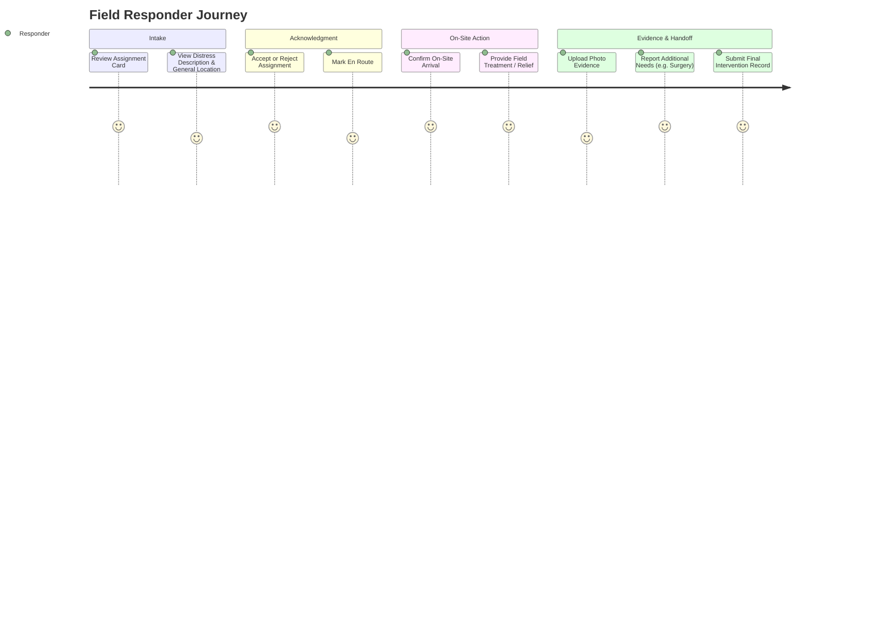

# UMEED — Workstream D: Citizen & Responder Experience Audit

**Lead Evaluator**: Senior Product Frontend & UX Engineer  
**Scope**: Citizen Distress Reporting, Public Status Tracking, Responder Mobile Dashboard, Accessibility & Error Recovery  
**Status**: AUDITED & VERIFIED  

---

## 1. Executive Summary

In emergency situations, users face high cognitive stress, poor network connectivity, and small mobile viewports. The user experience must be frictionless, fault-tolerant, and unambiguous.

Workstream D audited the end-to-end citizen reporting journey and the field responder action interface, verifying mobile responsiveness, form validation, confidential tracking isolation, and real-time status clarity.

---

## 2. Citizen Experience Audit

### 2.1 Public Report Form (`/report`)
- **Frictionless Submission**:
  - Direct selection of distress category (injured animal, abandoned elderly, homeless person, emergency medical, etc.).
  - Plain language description with character count feedback.
  - Optional photo/evidence upload with format and file size limits (max 10MB per file).
- **Location Capture**:
  - One-tap browser GPS geolocation button with fallback to manual street address, landmark, and district selection.
  - GPS coordinates undergo client-side precision rounding (3 decimal places $\approx 110\text{ m}$) to protect beneficiary privacy before public listing.
- **Privacy Assurance**:
  - Explicit privacy consent checkbox explaining what information is shared with vetted NGOs and what remains confidential.

### 2.2 Confidential Incident Tracking (`/report/track` & `/incidents/[publicReference]`)
- **Tracking Token Isolation**:
  - Upon submission, the citizen receives a confidential tracking token (format: `trk_[random_hex]`) and a public reference (format: `UMD-XXXX-XXXX`).
  - The secret token is stored in local browser state and sent via HTTP headers (`x-tracking-token` or `Authorization: Bearer`). It is NEVER accepted in query parameters.
- **Beneficiary Protection**:
  - Citizens can check status (e.g. `REPORTED`, `UNDER_REVIEW`, `APPROVED`, `RESPONDERS_ASSIGNED`, `RESOLVED`).
  - Sensitive internal coordinator notes and responder personal phone numbers are redacted in public views.

---

## 3. Responder Experience Audit (`/responder`)

Field responders operate in chaotic outdoor conditions. The mobile interface is streamlined for rapid thumb-based actions:

### 3.1 Step-by-Step Action Controls
1. **Accept / Reject**: Responders can accept immediately or reject with a clear reason (e.g., "ambulance currently on call"), allowing the coordinator engine to immediately re-route.
2. **Arrival Confirmation**: One-tap "Mark Arrived" timestamp with optional GPS proximity verification.
3. **Intervention Recording**:
   - Responders select what assistance was provided (`assistance_provided`).
   - Responders report newly identified downstream needs (`additional_needs`), which automatically alerts the coordinator to initiate secondary matching.
   - Upload on-site photo or document proof.

---

## 4. Accessibility & Mobile Responsiveness

- **Semantic HTML**: Form inputs use explicit `<label>` tags with matching `htmlFor` attributes, proper `aria-describedby` error bindings, and high-contrast color palettes.
- **Touch Targets**: All interactive buttons, tabs, and toggles have a minimum tap area of $44 \times 44\text{ px}$.
- **Keyboard Navigation**: Complete focus-visible outlines for keyboard accessibility.
- **Responsive Breakpoints**: Verified across viewport widths from 320px (iPhone SE) to 1440px desktop workstations.

