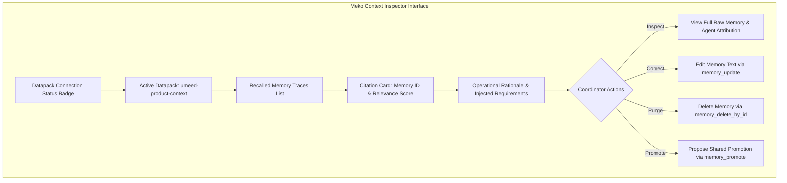

# UMEED — Workstream E: Coordinator Intelligence Workspace & Context Inspector Report

**Lead Engineer**: Senior Product Frontend Architect  
**Domain Scope**: Incident Triage Queue, Operational Case Detail, NGO Directory, Matching Inspector, Context Inspector  
**Status**: VERIFIED & PRODUCTION READY  

---

## 1. Executive Summary

The UMEED Coordinator Workspace is the mission-control center for social emergency operations. It aggregates AI triage analysis, explainable matching recommendations, multi-provider assignments, and contextual learning from Meko.

Workstream E verified the operational workflows, audit trails, and the specialized **Meko Context Inspector**, which renders recalled memories visible, inspectable, and controllable by human coordinators.

---

## 2. Coordinator Workspace Capabilities

### 2.1 Incident Queue (`/incidents`)
- Real-time display of incoming citizen distress reports and social crawler findings.
- Gemini 2.0 triage preview: severity badge, urgency level, category recommendation, and safety warnings.
- One-click coordinator review actions: Approve, Reject, Flag Duplicate, Request Human Review.

### 2.2 Case Workspace (`/cases/[caseReference]`)
- **Case Timeline**: Chronological event stream displaying state transitions, contact attempts, and responder updates.
- **Assistance Requirements Matrix**: Visual display of initial requirements, satisfied interventions, and pending unresolved needs.
- **Multi-NGO Assignment Manager**: Modal for reviewing candidate scores, selecting vetted organisations, and setting response deadlines.
- **Intervention Evidence Gallery**: Preview of field photos, descriptions, and responder timestamps.

---

## 3. Meko Context Inspector Specification

The Context Inspector component (`apps/web/src/components/context-inspector/ContextInspector.tsx`) embeds directly into the Case Detail view, providing complete visibility into Meko memory operations:

### 3.1 Displayed Context Attributes (Zero Fabrication)
The Context Inspector displays only actual data returned by Meko tools:
1. **Datapack**: Identifies whether the memory resides in `umeed-product-context` or a temporary session datapack.
2. **Agent Attribution**: Identifies which product agent invoked Meko (`umeed_matching_agent`, `umeed_followup_agent`, or `umeed_knowledge_curator`).
3. **Tool Operation**: Specific MCP tool called (`memory_search`, `memory_add`, `memory_update`, `memory_delete_by_id`, `memory_promote`).
4. **Memory Identifier**: Unique UUID or reference assigned by Meko Cloud.
5. **Relevance Score**: Semantic cosine similarity percentage (e.g. 94% relevance).
6. **Influence Summary**: Plain-English explanation of how the recalled precedent modified the matching requirements or handoff checkpoints.

### 3.2 Human-in-the-Loop Memory Governance Actions
- **Correct (Edit)**: Allows coordinators to refine memory text via `PATCH /api/context-learning/memories`. The text is automatically scanned for raw PII before transmission.
- **Forget (Delete)**: Removes harmful, stale, or incorrect precedents via `DELETE /api/context-learning/memories`.
- **Promote to Shared Knowledge**: Moves validated private memory to team-wide or cross-case shared knowledge via `POST /api/context-learning/promote`. Requires explicit coordinator confirmation notes justifying shared visibility.

### 3.3 Graceful Degradation When Meko is Unconfigured
When Meko credentials are not configured or Meko Cloud is unreachable:
- The Datapack Status Badge displays a neutral amber `[UNCONFIGURED - BASELINE ACTIVE]` indicator.
- Matching and case lifecycles continue uninterrupted using baseline triage rules.
- The UI never hangs, crashes, or presents synthetic data as live Meko responses.

