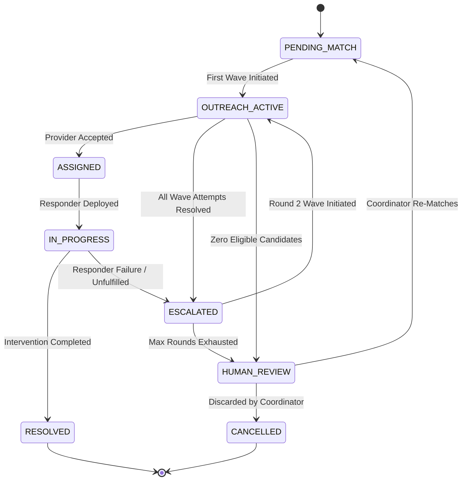
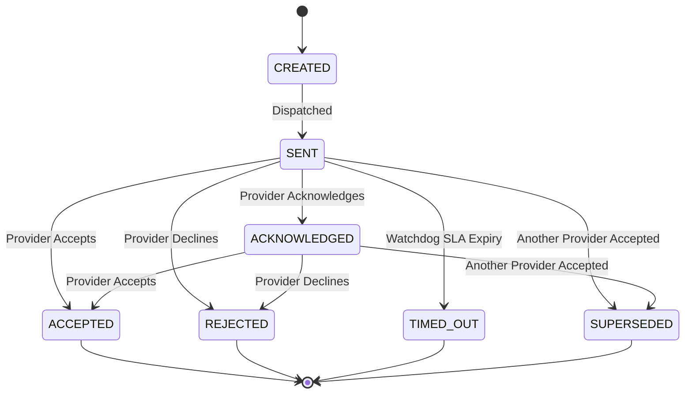

# UMEED — Core Assistance & NGO Matching Engine Architecture

## 1. Executive Summary

UMEED's **Core Assistance Engine** coordinates rapid, reliable, and explainable social distress response across Delhi, India. It introduces a multi-stage assistance pipeline that transitions verified distress reports into fulfilled field interventions through:

1. **Geospatial & Multi-Factor Provider Ranking**: Combines exact road travel time estimation (with Delhi urban winding factor), service capability matching, Bayesian-smoothed reliability, real-time availability, territorial coverage, and freshness decay into a normalized $[0, 100]$ score.
2. **First-Round Outreach Management**: Dispatches deterministic, idempotent outreach waves to top-ranked providers, configures SLA acknowledgement deadlines, and records truthful notifications via a persistent outbox.
3. **Atomic Acceptance & Invalidation**: Guarantees that the first responding provider atomically claims the requirement, while all competing active attempts for that requirement are transitioned to `SUPERSEDED`, eliminating duplicate outreach or conflicting field assignments.
4. **Dual Escalation Architecture**:
   - **Path A (Provider Failure)**: Automatically escalates to Round 2 upon rejection, timeout, or failure, applying workload and timeout penalties while excluding previously contacted providers. Upon exhausting retry limits, it routes cases to human coordinators (`HUMAN_REVIEW`).
   - **Path B (Assistance Insufficiency)**: Supports complex multi-need cases by creating linked child requirements (e.g. food, temporary shelter, trauma surgery) that run independent outreach and matching lifecycles while preserving primary assignments.
5. **No-Cold-Case Watchdog & Observability**: Sweeps the system deterministically to prevent stale cases, enforces acknowledgement SLA timeouts, retries failed notifications, and guarantees that every open case has an assigned owner and a scheduled next action.

---

## 2. Multi-Factor Scoring & Ranking Algorithm

### 2.1 Formula Specification

The engine ranks candidate provider service locations for each assistance requirement using a 6-component weighted model:

$$\text{BaseScore} = 0.25 \times S_{\text{dist}} + 0.20 \times S_{\text{cap}} + 0.20 \times S_{\text{rel}} + 0.15 \times S_{\text{avail}} + 0.10 \times S_{\text{cov}} + 0.10 \times S_{\text{fresh}}$$

Where:

- **Distance Score ($S_{\text{dist}}$)**:
  $$\text{travelTimeMinutes} = \frac{\text{haversineDistanceKm} \times 1.35}{25.0} \times 60$$
  $$S_{\text{dist}} = 100 \times \exp\left(-\frac{\text{travelTimeMinutes}}{30}\right)$$
  Incorporates a 1.35 urban road winding factor for Delhi's transit topology and an average urban traffic speed of 25 km/h. Missing coordinates fall back to a neutral score of 50.

- **Capability Score ($S_{\text{cap}}$)**:
  - Exact match on supported service category: $100$
  - Secondary supported service: $75$
  - Allied referral capability: $40$
  - Unsupported service: $0$ (fails hard eligibility filter).

- **Reliability Score ($S_{\text{rel}}$)**:
  Uses Bayesian smoothing with a neutral prior ($\alpha = 2, \beta = 2$) giving new or unproven organizations a baseline score of $50\%$:
  $$R_{\text{bayes}} = \frac{\text{successfulResponses} + \alpha}{\text{eligibleResolvedAttempts} + \alpha + \beta}$$
  $$S_{\text{rel}} = 100 \times R_{\text{bayes}}$$
  When category-specific history has $\ge 3$ resolved attempts, category metrics take precedence over global metrics.

- **Availability Score ($S_{\text{avail}}$)**:
  - `CONFIRMED_AVAILABLE`: $100$
  - `LIMITED_CONFIRMED`: $70$
  - `UNKNOWN`: $40$
  - `NO_CAPACITY` / `CLOSED_SUSPENDED`: $0$ (fails hard eligibility filter).

- **Coverage Score ($S_{\text{cov}}$)**:
  - Exact Ward-level match: $100$
  - Adjacent Ward-level match: $75$
  - Confirmed All-Delhi mandate: $85$
  - District-level match: $65$
  - Out-of-area / Unknown: $30$.

- **Freshness Score ($S_{\text{fresh}}$)**:
  $$S_{\text{fresh}} = 100 \times \exp\left(-\frac{\text{daysSinceVerification}}{30}\right)$$
  Unverified or stale data defaults to 30.

### 2.2 Round 2 Penalties

In Round 2 escalation waves:

$$\text{FinalScore} = \max(0, \text{BaseScore} - P_{\text{repeat}} - P_{\text{workload}})$$

- **Repeat Timeout Penalty ($P_{\text{repeat}}$)**: $-15$ points if the provider recently timed out on outreach for this requirement.
- **Active Workload Penalty ($P_{\text{workload}}$)**:
  $$P_{\text{workload}} = \min\left(30, \text{round}\left(30 \times \frac{\text{activeCases}}{\max(1, \text{capacity})}\right)\right)$$

---

## 3. State Machines & Transition Rules

### 3.1 Assistance Requirement Lifecycle

### 3.2 Outreach Attempt Lifecycle

---

## 4. Multi-Need Assistance Support (Path B Escalation)

When a distress case requires multiple distinct forms of assistance (e.g. initial medical ambulance plus supplemental food and temporary shelter), UMEED decouples individual needs into child requirements:

1. **Preservation**: The original assignment and intervention records remain intact and in progress.
2. **Independent Lifecycles**: The supplemental requirement is created with `parentRequirementId: primaryRequirement.requirementId` and enters its own geospatial discovery and outreach pipeline.
3. **No Closed-Loop Gaps**: The parent case remains open (`SUPPLEMENTAL_REQUIRED` or `IN_PROGRESS`) until every associated assistance requirement has transitioned to `RESOLVED`.

---

## 5. Idempotency & Concurrency Safeguards

1. **Idempotent Dispatch**:
   $$\text{IdempotencyKey} = \text{SHA256}(\text{requirementId} : \text{outreachRound} : \text{outreachVersion} : \text{providerId})$$
   Duplicate calls return existing attempts without creating duplicate notification queue records or database entries.
2. **Atomic Acceptance**:
   Acceptance validates that `attempt.outreachVersion === requirement.outreachVersion` and verifies no active assignment exists for another provider. Upon winning, all competitor attempts in the same wave are atomically set to `SUPERSEDED` with `supersededAt` timestamps recorded.
3. **Truthful Notification Mocking**:
   When live production SMS or WhatsApp gateway credentials are not configured, notification outbox items are stored with status `SIMULATED_MOCK` or `PENDING`, avoiding fabricated delivery receipts.

---

## 6. Verification & Quality Assurance

The implementation is verified against all 20 mandatory engine test scenarios covering:
- Haversine distance accuracy for Delhi landmarks.
- Urban road winding factor (1.35) and congestion transit velocity (25 km/h).
- Geospatial radius expansion tiers (10km -> 20km -> 35km -> territorial fallback).
- Multi-factor scoring mathematical guarantees and explainable reasoning generation.
- Bayesian reliability smoothing for unproven providers (50% neutral prior).
- Category-specific response rate smoothing when sample size $\ge 3$.
- Freshness exponential decay.
- Availability status classification and hard filtering.
- Round 2 workload and timeout penalties.
- Deterministic outreach waves, acknowledgement, atomic acceptance, competitor invalidation, and conflict rejection.
- Path A round escalation and human review routing.
- Path B supplemental requirement creation and watchdog SLA recovery sweeps.

