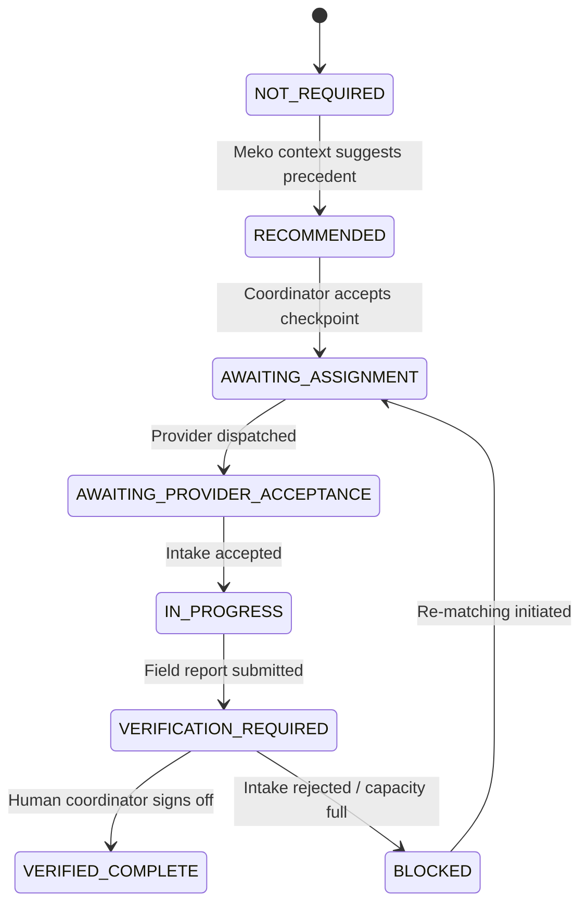

# UMEED — Handoff Intelligence Architecture

**Document Version**: 1.0.0  
**Evaluator**: Principal AI Agent Architect & Systems Engineer  
**Target Domain**: Multi-Stage Assistance Coordination & Recursive Handoffs  

---

## 1. The Multi-Stage Handoff Problem

In social distress discovery and closed-loop coordination, initial field rescue does not constitute complete assistance.

### Common Real-World Vulnerability

1. An animal is rescued from a traffic accident and transported.
2. The initial rescue volunteer marks their assignment as completed.
3. Without explicit receiving-provider tracking, the patient is left unadmitted or turned away if the destination shelter lacks emergency surgical staff.
4. The assistance case is prematurely marked as "RESOLVED", stranding the beneficiary.

### UMEED Handoff Intelligence Solution

UMEED introduces a deterministic **Handoff Intelligence Engine** augmented by **Meko Historical Precedents**:

- Distinguishes physical transit from receiving-provider medical admission.
- Injects mandatory verification checkpoints into the case workspace.
- Requires affirmative human coordinator sign-off before case closure.
- Enforces loop-prevention caps (maximum 3 cycles) to prevent infinite dispatch cycles.

---

## 2. Checkpoint State Progression Model

Handoff checkpoints follow a strict sequential progression:

### Checkpoint Fields

- `checkpoint_id`: Unique stable identifier (e.g. `chk_receiving_acceptance`).
- `requirement_id`: Underlying assistance requirement (e.g. `req_veterinary_handoff`).
- `title`: Human-readable label (e.g. "Receiving Provider Acceptance").
- `required_action`: Detailed directive for field responders and coordinators.
- `responsible_provider_or_role`: Assigned entity or role.
- `current_status`: Current lifecycle state.
- `stage_order`: Numerical sequence (e.g. 1 = Rescue, 2 = Acceptance, 3 = Discharge).
- `evidence_of_completion`: Substantive evidence text provided by the human coordinator.
- `verification_timestamp`: ISO 8601 timestamp of verification.
- `requires_human_confirmation`: Always `true` for critical handoff stages.
- `is_context_injected`: Flag indicating whether the checkpoint originated from a Meko memory.
- `injected_by_memory_id`: Reference to originating Meko memory.

---

## 3. Human In The Loop (HITL) Guarantees

UMEED enforces four fundamental invariants:

1. **Meko Context Never Closes a Checkpoint**: Meko context may propose, recommend, or surface checkpoints, but can **never** mark a checkpoint complete.
2. **Substantive Evidence Mandate**: Human verification requires a minimum of 5 characters of descriptive evidence (e.g. hospital admission slip number, doctor name). Empty or trivial acknowledgments ("ok", "done") are rejected.
3. **Multi-Stage Resolution Gate**: A case cannot transition to `RESOLVED` while any active checkpoint remains in `VERIFICATION_REQUIRED`, `AWAITING_PROVIDER_ACCEPTANCE`, or `BLOCKED` state.
4. **Infinite Loop Protection**: Automated cycle progression terminates at `maxCycles` (default 3), forcing immediate `ESCALATE_TO_COORDINATOR` escalation if handoffs remain unresolved.
