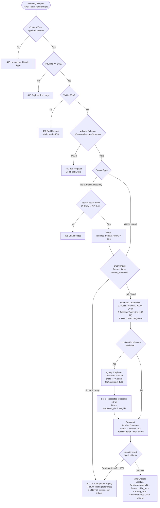

# UMEED Incident Ingestion Flow & Lifecycle Architecture

**System**: UMEED (Closed-Loop Social Distress Assistance Platform)  
**Phase**: Phase 2 — Incident Ingestion Engine  
**Protocol**: HTTP POST `/api/incidents/ingest`  

---

## 1. End-to-End Ingestion Flow

---

## 2. Step-by-Step Processing Pipeline

### Step 1: Pre-Flight Gatekeeper & Request Limits

1. Validates `Content-Type: application/json`. Non-JSON requests receive `415 Unsupported Media Type`.
2. Validates `Content-Length <= 1048576` (1MB). Payloads exceeding the limit receive `413 Payload Too Large`.
3. Parses JSON safely in a try-catch block, returning `400 Bad Request` on malformed inputs.

### Step 2: Canonical Contract Validation (`@umeed/contracts`)

1. Validates payload using `CanonicalIncidentSchema.safeParse()`.
2. Schema enforces explicit `.max()` bounds preventing memory exhaustion:
   - `description`: 1 to 5000 characters
   - `evidence`: Maximum 25 items
   - `reasoning`: Maximum 20 strings
   - `coordinates`: Latitude `[-90, 90]`, Longitude `[-180, 180]`
3. If invalid, the handler formats field errors into an RFC 7807 problem details response with HTTP `400`.

### Step 3: Authorization Boundary

- **Citizen Submission**: Publicly accessible; rate-limited at reverse proxy/gateway layer.
- **Discovery Crawler Submission**: Authenticated via `X-Crawler-API-Key` or `Authorization: Bearer <key>`. Verified in constant time (`crypto.timingSafeEqual`). If missing or invalid, returns `401 Unauthorized`.
- **Ethical Invariant**: Any incident ingested via `social_media_discovery` is unconditionally flagged with `requires_human_review = true`.

### Step 4: Strict Idempotency Check

1. The repository queries `{ source_type: payload.source_type, source_reference: payload.source_reference }`.
2. If found, the endpoint short-circuits with `200 OK` and `is_duplicate: true`.
3. **Security Invariant**: The confidential plaintext `tracking_token` is **never re-issued on idempotent replays**.

### Step 5: Cryptographic Token Generation

1. `public_reference`: Human-readable reference formatted as `UMD-XXXX-YYYY` (e.g., `UMD-7B29-4K12`).
2. `tracking_token`: Generated via `crypto.randomBytes(24).toString("base64url")` providing 192 bits of entropy.
3. `tracking_token_hash`: Computed as `SHA-256(tracking_token)`. Only this hash is stored in the database.

### Step 6: Non-Destructive Duplicate Candidate Detection

1. If the report includes valid GPS coordinates, the system queries the database for nearby incidents within **500 meters** and **24 hours** matching the same `subject_type` (person vs. animal).
2. If matches exist, the incident is flagged: `is_suspected_duplicate = true` and candidate references are recorded.
3. **Architectural Invariant**: Candidate reports are **never deleted, merged, or overwritten**.

### Step 7: Persistence & Incident-to-Case Isolation

1. The document is inserted into the `incidents` collection with initial status **`REPORTED`**.
2. **Architectural Invariant**: Ingestion **NEVER** creates an assistance `Case` or dispatches an NGO. A Case can only be initiated following an authorized human review decision in Phase 3/5.
3. If concurrent requests create a race condition on `{ source_type, source_reference }`, MongoDB throws error `E11000`. The service catches this atomically and returns the existing incident idempotently.
