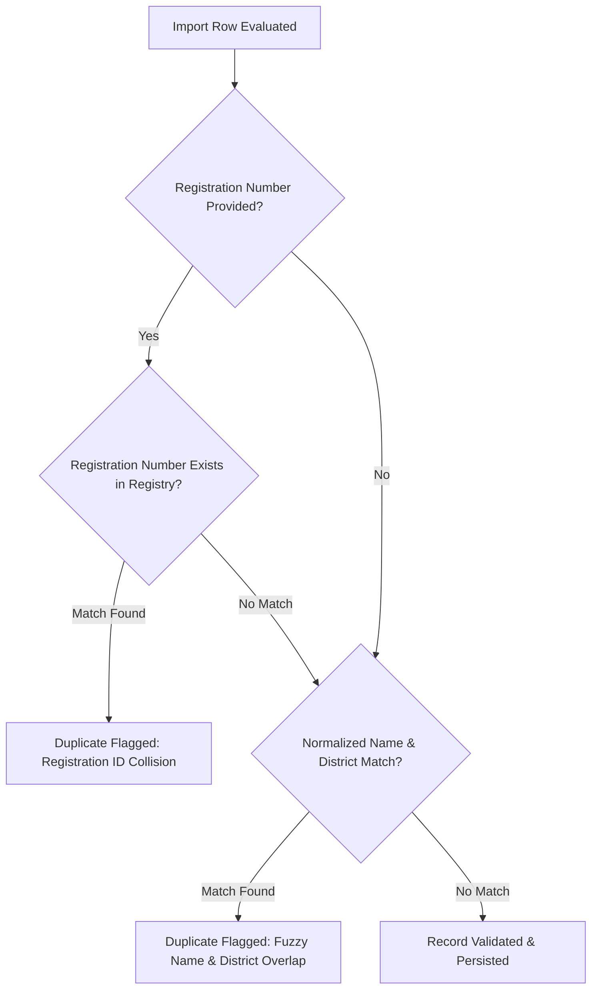

# UMEED NGO Data Ingestion & Import Specification (Phase 4)

**Module**: `apps/web/src/features/ngos/services/csv-import.service.ts`  
**Endpoint**: `POST /api/ngos/import`  
**Role**: Principal Backend Architect & Geospatial Data Engineer  

---

## 1. Overview

The UMEED NGO Data Ingestion pipeline allows verified coordinators to import organization rosters via RFC 4180-compliant CSV datasets. The pipeline performs row-level validation, duplicate detection, geospatial coordinate normalization, and category mapping.

---

## 2. Ingestion Security & Authorization

- **Coordinator Authorization**: The endpoint `POST /api/ngos/import` requires authenticated coordinator privileges (`x-coordinator-key` or `Authorization: Bearer <key>`). Unauthenticated requests fail closed with `401 Unauthorized`.
- **Payload Limits**: Maximum CSV file size is bounded to 5 MB per import batch to protect server memory and prevent resource exhaustion.
- **Fail-Safe Processing**: A parsing error in a single row does not abort the entire batch. Valid rows are persisted, while malformed or duplicate rows are recorded in a detailed row-by-row validation report.

---

## 3. CSV File Specification (RFC 4180)

### 3.1 Column Definitions

| Column Name | Type | Required | Description / Example |
|---|---|:---:|---|
| `organisation_name` | String | **Yes** | Official name (e.g. `Delhi Animal Welfare Society Trust Regd`) |
| `alternate_names` | String | No | Semicolon-separated aliases (e.g. `DAWST; Animal Care Delhi`) |
| `registration_number` | String | No | Unique registration or DARPAN ID (e.g. `DL/2018/0184920`) |
| `registration_authority` | String | No | Registrar authority (e.g. `Registrar of Societies, Govt of NCT of Delhi`) |
| `organisation_type` | String | **Yes** | `trust`, `society`, `section_8_company`, `unregistered_collective`, `government_nodal_agency`, `volunteer_group`, `other` |
| `service_categories` | String | **Yes** | Semicolon-separated categories: `injured_animal`, `homeless_person`, `medical_assistance`, etc. |
| `supported_subject_types` | String | **Yes** | Semicolon-separated: `person`, `animal`, or `person; animal` |
| `assistance_capabilities` | String | No | Semicolon-separated list: `animal_ambulance; surgical_ward; rabies_quarantine` |
| `operational_districts` | String | **Yes** | Semicolon-separated districts: `South Delhi; New Delhi; South West Delhi` |
| `hq_address` | String | **Yes** | Physical street address of main office or facility |
| `hq_district` | String | **Yes** | Administrative district of headquarters |
| `hq_state` | String | **Yes** | State / UT (e.g. `Delhi`, `Haryana`) |
| `hq_pincode` | String | No | Postal code (e.g. `110074`) |
| `hq_latitude` | Float | **Yes** | Decimal latitude (-90.0 to 90.0, e.g. `28.5245`) |
| `hq_longitude` | Float | **Yes** | Decimal longitude (-180.0 to 180.0, e.g. `77.1855`) |
| `verification_status` | String | No | Defaults to `UNVERIFIED`. Options: `PUBLICLY_LISTED`, `REGISTRATION_CHECKED`, `UNVERIFIED` |
| `availability_status` | String | No | `AVAILABLE_24_7`, `OPERATIONAL_HOURS`, `ON_CALL`, `UNKNOWN` |
| `operating_hours` | String | No | Operating schedule (e.g. `09:00 - 18:00 Mon-Sat`) |
| `capacity_status` | String | No | `HIGH`, `MEDIUM`, `LOW`, `AT_CAPACITY`, `UNKNOWN` |
| `public_phone` | String | No | General phone / inquiry number |
| `public_email` | String | No | Official public email |
| `public_website` | String | No | Organization website URL |
| `public_helpline` | String | No | Emergency public hotline |
| `coordinator_name` | String | No | Confidential direct contact person |
| `coordinator_phone` | String | No | Confidential direct phone |
| `coordinator_email` | String | No | Confidential direct email |

> [!WARNING]
> **No Auto-Promotion Invariant**: Ingested records are **NEVER** automatically promoted to `OPERATIONALLY_VERIFIED`. Even if a CSV specifies `OPERATIONALLY_VERIFIED`, the ingestion parser safely caps the tier to `REGISTRATION_CHECKED` or `PUBLICLY_LISTED` until an authorized coordinator conducts an audit.

---

## 4. Duplicate Detection Algorithm

Before inserting an imported organization, the engine executes multi-factor duplicate checks:



1. **Registration Number Match**: If `registration_number` is provided, the database performs a case-insensitive exact match check against existing records.
2. **Normalized Name & District Match**:
   - The organization name is stripped of common legal corporate suffixes (`"trust"`, `"society"`, `"ngo"`, `"foundation"`, `"regd"`, `"ltd"`).
   - If the normalized token set overlaps $\ge 80\%$ with an existing active organization and both share at least one operational district, the row is flagged as a potential duplicate.

---

## 5. Import Validation Report (`ImportValidationReport`)

Every execution of `POST /api/ngos/import` returns a complete execution report:

```json
{
  "status": "success",
  "data": {
    "total_rows": 12,
    "imported_count": 10,
    "skipped_count": 2,
    "duplicate_count": 1,
    "error_count": 1,
    "errors": [
      {
        "row_number": 4,
        "organisation_name": "Animal Care Delhi",
        "reason": "Duplicate organization: Registration number DL/2018/0184920 already exists"
      },
      {
        "row_number": 9,
        "organisation_name": "Invalid Coords NGO",
        "reason": "Invalid latitude: 128.5245 exceeds range [-90, 90]"
      }
    ]
  }
}
```
