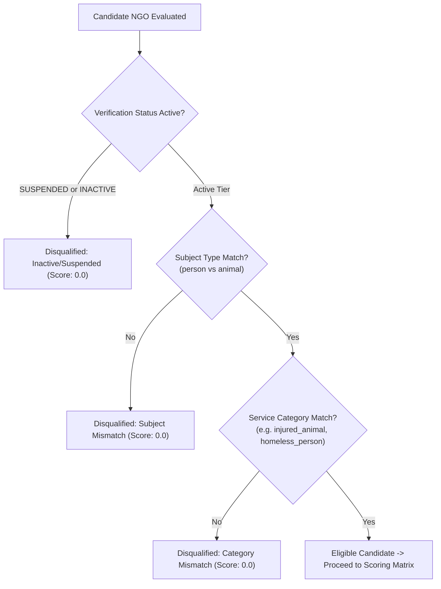

# UMEED Explainable Matching Engine Specification (Phase 4)

**Module**: `apps/web/src/features/matching/`  
**Endpoint**: `GET /api/ngos/matches/:incidentReference`  
**Role**: Principal Recommendation Systems Architect & Full-Stack Engineer  

---

## 1. Principles & Architectural Invariants

The UMEED Matching Engine ranks humanitarian and animal rescue organisations for a verified distress incident. It adheres to three strict non-negotiable principles:

1. **Human Agency Invariant**: The matching engine **recommends** candidates; it **NEVER automatically dispatches** teams or contacts responders. Only an authorized human coordinator can review, select, and initiate contact.
2. **Hard Capability Over Proximity**: Proximity never overrides capability. An organisation that is 500 meters away from an injured dog but specialises in elderly homelessness care is strictly disqualified (`eligible = false`, `score = 0.0`).
3. **Full Algorithmic Transparency**: Black-box ranking is prohibited. Every recommendation includes a breakdown of component scores, distance measurements, missing information notices, and human-readable justifications.

---

## 2. Hard Capability Pre-Filter (Elimination Gate)

Before any numerical scoring occurs, candidate NGOs must clear binary elimination criteria:



### Ineligibility Reasons Flagged
- `"Organisation does not service {incident_type} incidents"`
- `"Organisation does not handle {subject_type} distress cases"`
- `"Organisation verification is currently suspended"`
- `"Organisation marked as inactive"`

---

## 3. Mathematical Scoring Matrix

Once an organisation passes the hard capability pre-filter, its composite score ($S \in [0.0, 1.0]$) is computed using normalized multi-criteria weighting:

$$S = \Big( (w_{\text{cap}} \cdot S_{\text{cap}}) + (w_{\text{cov}} \cdot S_{\text{cov}}) + (w_{\text{dist}} \cdot S_{\text{dist}}) + (w_{\text{avail}} \cdot S_{\text{avail}}) + (w_{\text{capa}} \cdot S_{\text{capa}}) \Big) \times M_{\text{tier}}$$

### Default Weight Configuration
| Factor | Weight ($w_i$) | Purpose |
|---|:---:|---|
| **Capability** | `0.40` | Depth of alignment with specific distress needs |
| **Geographic Coverage** | `0.25` | Mandated operational presence in target district |
| **Physical Distance** | `0.15` | Geodesic Haversine distance from incident GPS to HQ |
| **Availability** | `0.10` | 24/7 readiness vs. operating hour constraints |
| **Capacity** | `0.10` | Live operational capacity and resource headroom |

$$\sum w_i = 0.40 + 0.25 + 0.15 + 0.10 + 0.10 = 1.00$$

---

### Component Score Formulas ($S_i \in [0.0, 1.0]$)

#### 1. Capability Score ($S_{\text{cap}}$)
- **Base Score**: `0.70` for passing the category match.
- **Granular Capability Bonus**: Up to `+0.30` if specific capabilities (e.g. `"animal_ambulance"`, `"medical_ward"`) match keywords in the incident description or triage requirements.

#### 2. Geographic Coverage Score ($S_{\text{cov}}$)
- `1.00`: Target incident district is explicitly in the organisation's `operational_districts`.
- `0.30`: Incident district is not in `operational_districts`, but matches the headquarters district.
- `0.00`: Neither district matches (relies entirely on broad travel capability).

#### 3. Distance Score ($S_{\text{dist}}$)
Calculated via the **Haversine Geodesic Formula** measuring great-circle distance $d$ in kilometers:

$$d = 2r \arcsin \left( \sqrt{ \sin^2\left(\frac{\Delta \phi}{2}\right) + \cos(\phi_1)\cos(\phi_2)\sin^2\left(\frac{\Delta \lambda}{2}\right) } \right)$$

Where $r = 6371\text{ km}$. The distance is mapped to a stepped piecewise function:
- $d \le 5\text{ km}$: `1.00` (Immediate vicinity)
- $5 < d \le 15\text{ km}$: `0.80` (Fast response range)
- $15 < d \le 30\text{ km}$: `0.60` (Moderate transit range)
- $30 < d \le 50\text{ km}$: `0.40` (Long transit range)
- $d > 50\text{ km}$: `0.10` (Edge of service territory)

#### 4. Availability Score ($S_{\text{avail}}$)
- `AVAILABLE_24_7`: `1.00`
- `OPERATIONAL_HOURS`: `0.85`
- `ON_CALL`: `0.70`
- `UNKNOWN`: `0.50` (Neutral baseline)
- `TEMPORARILY_UNAVAILABLE`: `0.00`

#### 5. Capacity Score ($S_{\text{capa}}$)
- `HIGH`: `1.00` (Significant resource headroom)
- `MEDIUM`: `0.80` (Standard operational capacity)
- `LOW`: `0.50` (Constrained resources)
- `UNKNOWN`: `0.50` (Neutral baseline)
- `AT_CAPACITY`: `0.00` (No intake capacity)

#### 6. Verification Status Tier Multipliers ($M_{\text{tier}}$)
- `OPERATIONALLY_VERIFIED`: $\times 1.00$
- `REGISTRATION_CHECKED`: $\times 0.90$
- `PUBLICLY_LISTED`: $\times 0.75$
- `UNVERIFIED`: $\times 0.50$
- `SUSPENDED` / `INACTIVE`: $\times 0.00$

---

## 4. Edge Cases & Safeguard Policies

### 4.1 Missing or Low-Confidence Location
- If an incident has `latitude: null`, `longitude: null`, or `confidence < 0.50`, distance cannot be calculated reliably.
- **Handling**: `distance_km` is set to `null`, and `distance_score` is assigned a neutral baseline of `0.50` without penalizing the candidate.
- **Auditing**: A prominent notice is appended to `missing_information`:
  `"Incident coordinates missing or low-confidence; distance score set to neutral baseline (0.50)"`.

### 4.2 Historical Response Safeguard
- An organisation with 1 completed dispatch and 0 failures should not appear superior to an organisation with 90 completed dispatches out of 100 due to small-sample skew.
- **Handling**: Historical metrics are **completely excluded** from scoring whenever `sample_size < 5`.
- **Auditing**: A notice is added to `missing_information`:
  `"Historical metrics excluded (sample size < 5)"`.

### 4.3 Unknown Availability or Capacity
- Newly registered or imported NGOs may not have real-time availability telemetries.
- **Handling**: Rather than penalizing with 0 or assuming 24/7 readiness, a neutral score of `0.50` is assigned.
- **Auditing**: Flagged in `missing_information` for coordinator awareness.

---

## 5. Output Payload Schema

Recommendations returned by `GET /api/ngos/matches/:incidentReference`:

```json
{
  "status": "success",
  "data": {
    "incident_reference": "UMD-7B29-4K12",
    "evaluated_candidates_count": 8,
    "eligible_candidates_count": 3,
    "matched_candidates": [
      {
        "ngo_id": "ngo_del_001",
        "organisation_name": "Delhi Animal Welfare Society Trust Regd",
        "eligible": true,
        "composite_score": 0.892,
        "component_scores": {
          "capability_score": 0.95,
          "coverage_score": 1.0,
          "distance_score": 0.8,
          "availability_score": 1.0,
          "capacity_score": 0.8,
          "history_score": null
        },
        "distance_km": 8.4,
        "ineligibility_reasons": [],
        "explanation": "High capability alignment with 24/7 emergency response in South Delhi (8.4 km away).",
        "missing_information": []
      }
    ],
    "weights_applied": {
      "capability": 0.40,
      "coverage": 0.25,
      "distance": 0.15,
      "availability": 0.10,
      "capacity": 0.10
    },
    "explanation_summary": "Top recommendation: Delhi Animal Welfare Society Trust Regd (Score: 89%). 3 eligible organisations identified.",
    "generated_at": "2026-10-31T14:30:00.000Z"
  }
}
```
