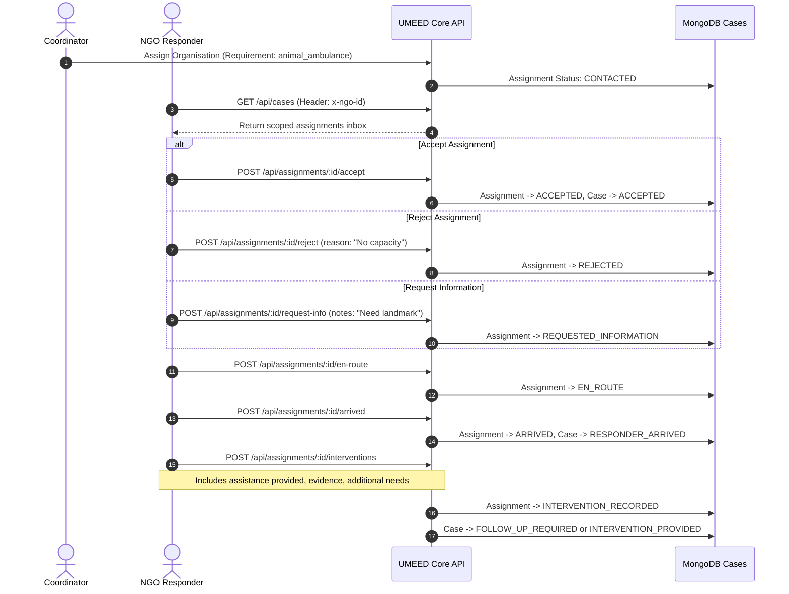

# UMEED NGO Responder Operational Guide

## 1. Overview

The UMEED NGO Responder Terminal (`/responder`) enables frontline distress organisations, rescue teams, and field workers to manage incoming assistance requests, commit resources, signal on-scene arrival, and submit evidence-backed intervention records.

---

## 2. Authentication & Multi-Persona Switching

In production, responders authenticate via cryptographic tokens or OAuth sessions bound to their verified organisation ID.

For development, testing, and HackCBS evaluation, the terminal supports header-based persona switching using verified synthetic demo NGOs:

| Header | Format | Purpose |
| --- | --- | --- |
| `x-ngo-id` | `DEMO-NGO-001` or `ngo_del_001` | Identifies the responding organisation tenant. |
| `x-responder-id` | `resp_dr_vikram` | Identifies the field responder individual. |

### Available Demo Personas

1. **Delhi Animal Welfare Society Trust (`DEMO-NGO-001`)**: Animal ambulances, mobile trauma units, emergency field veterinary assistance.
2. **Apna Aashray Shelter Collective (`DEMO-NGO-002`)**: Night shelters, winter bedding, homeless emergency outreach.
3. **Sanjeevani Mobile Medical Care (`DEMO-NGO-003`)**: Street healthcare, wound management, outpatient triage.
4. **Annapurna Community Nutrition (`DEMO-NGO-004`)**: Hot meals, dry rations, emergency hunger relief.
5. **Vridh Seva Kendra (`DEMO-NGO-005`)**: Elderly abandonment rescue, geriatric care, nursing transit.
6. **Paws & Claws Rehabilitation (`DEMO-NGO-006`)**: Post-operative canine rehabilitation, animal quarantine ward.

---

## 3. Responder Operational Workflow

---

## 4. Privacy & Anti-Enumeration Protections

- **No Citizen Tracking Tokens**: Responders never receive citizen confidential tracking tokens (`trk_...`) in API responses or UI screens.
- **Location Precision**: Field responders receive verified operational coordinates and street references necessary for dispatch.
- **Derivatives Only**: Evidence previews are served through sanitized derivative endpoints; raw citizen EXIF metadata is stripped server-side.
