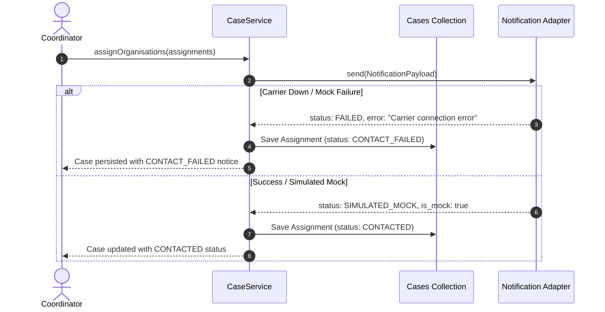

# UMEED Notification Architecture & Truthful Mock Adapter

## 1. Architectural Philosophy & Ethics Invariant

UMEED coordinates emergency operations. In production, notifying an NGO involves external carrier SMS, WhatsApp Business API, email gateways, or push notifications.

In development, demonstration, and hackathon judging environments, fabricating delivery success (e.g. logging fake telecommunications carrier ACKs or pretending an SMS reached a phone tower) is a critical integrity violation.

### Truthful Notification Invariant

- Every non-production notification attempt is explicitly marked as `is_mock: true` with status `SIMULATED_MOCK`.
- The system never claims carrier delivery when running in simulated mode.
- Audit trails, logs, and API payloads surface `status: "SIMULATED_MOCK"` and `delivered_via: "simulated_mock"`.

---

## 2. Notification Adapter Interface

The notification subsystem is decoupled behind a clean TypeScript contract:

```typescript
export interface INotificationAdapter {
  send(payload: NotificationPayload): Promise<SendNotificationResult>;
  isMock(): boolean;
  getChannelName(): string;
}
```

### Payloads & Results

```typescript
export interface NotificationPayload {
  notification_id: string;
  case_id: string;
  assignment_id: string;
  organisation_id: string;
  channel: "in_app" | "sms" | "whatsapp" | "email";
  recipient_address: string;
  subject: string;
  body: string;
  status: "QUEUED" | "DELIVERED" | "SIMULATED_MOCK" | "FAILED";
  created_at: string;
  delivered_at: string | null;
  error_message: string | null;
  is_mock: boolean;
}

export interface SendNotificationResult {
  success: boolean;
  status: "DELIVERED" | "SIMULATED_MOCK" | "FAILED";
  delivered_at?: string;
  error?: string;
}
```

---

## 3. Transactional Outbox Pattern & Failure Decoupling

Notification dispatch is decoupled from core case and assignment persistence:

1. **Transactional Resilience**: When a coordinator assigns an organisation, the case and assignment are written to the database first.
2. **Non-Fatal Delivery Failure**: If the notification carrier is unavailable or fails:
   - The assignment status is recorded as `CONTACT_FAILED`.
   - The contact attempt logs the exact failure details.
   - The case itself remains cleanly persisted in database state (`no rollback`).
   - The coordinator is alerted and can retry dispatch without losing case context.


