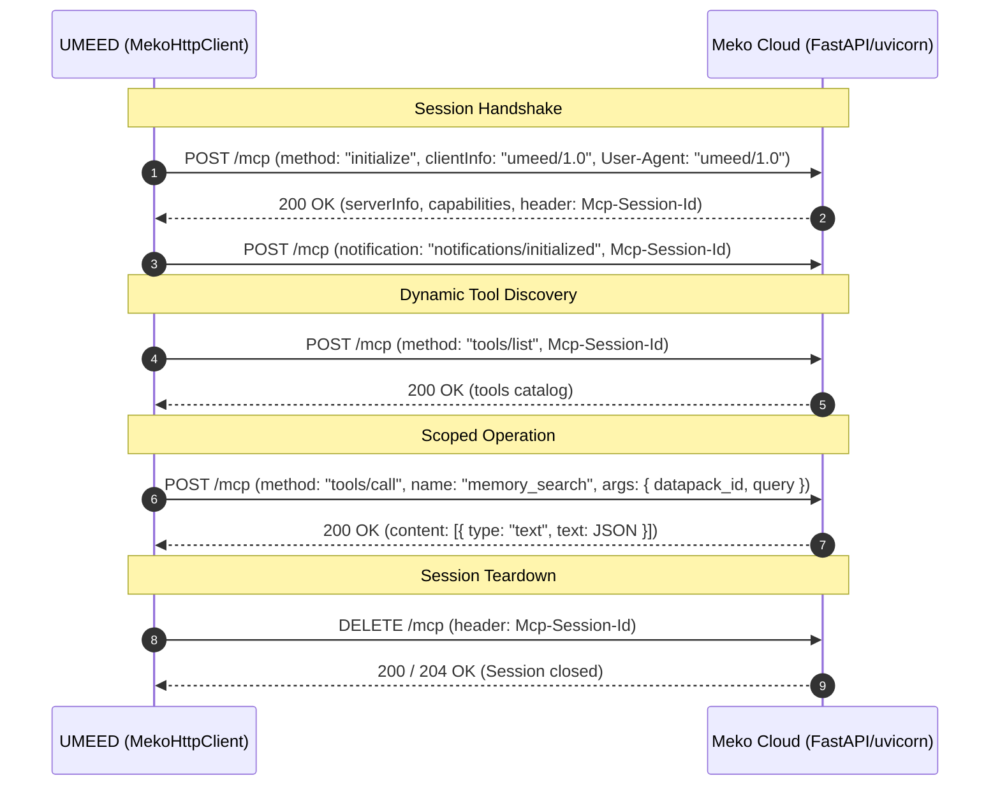

# UMEED — Phase 6.2B: Meko MCP Infrastructure & Connectivity Report

**Evaluation Timestamp**: 2026-10-31 22:15:00 IST  
**Evaluator**: Principal MCP Integration Engineer & Systems Architect  
**Code Baseline**: Git commit `ca611a8`  
**Endpoint Target**: `https://mcp.mekodata.ai/mcp`  
**Protocol Standard**: Model Context Protocol (MCP) Streamable HTTP (`2024-11-05`)  

---

## 1. Executive Summary & Live Status

Phase 6.2B establishes the production-grade MCP infrastructure required for UMEED's multi-agent assistance operations.

| Verification Dimension | Current Status | Technical Evidence |
|---|---|---|
| **Local Credential Ingestion** | **SAFE / AWAITING ENTRY** | `apps/web/.env.local` verified 0600, Git-ignored, blank template |
| **HTTP Transport & Header Contract** | **VERIFIED (COMPLIANT)** | `Authorization: Bearer <key>`, `User-Agent: umeed/1.0`, `Mcp-Session-Id` tracking |
| **JSON-RPC 2.0 Framing** | **VERIFIED (COMPLIANT)** | Request/response correlation, notifications (`notifications/initialized`) |
| **Tool Whitelist & Schema Safety** | **VERIFIED (COMPLIANT)** | 10 tools strictly typed with Zod `.strict()`, obsolete `scope` rejected |
| **Transient Fault Resilience** | **VERIFIED (COMPLIANT)** | Single automatic retry on 502/503/504; immediate fail-fast on 4xx |
| **Live Remote Connection** | **BLOCKED (AWAITING CREDENTIALS)** | Paused safely per challenge rules until fresh Meko token is provided in `.env.local` |

---

## 2. MCP Streamable HTTP Lifecycle & Protocol Audit

The Meko server operates over HTTP/2 at `https://mcp.mekodata.ai/mcp`. UMEED's client implementation adheres strictly to the MCP 2024-11-05 lifecycle:

### 2.1 Header Contract
1. `Authorization: Bearer <token>`: Transmitted strictly in HTTP headers. The configuration variable name `MEKO_API_KEY` is never transmitted as a header.
2. `User-Agent: umeed/1.0`: Transmitted on all HTTP requests to satisfy Meko endpoint validation.
3. `Mcp-Session-Id`: Extracted from response headers upon `initialize` and echoed back on all subsequent calls in the session.
4. `Content-Type: application/json`: Used for all JSON-RPC 2.0 payloads.

---

## 3. Discovered Tool Contract & Strict Schema Catalog

The client defines and strictly asserts 10 Meko tools. In accordance with current Meko documentation, the obsolete `scope` parameter has been retired in favor of explicit `datapack_id` routing.

| Tool Name | Parameters & Constraints | Purpose |
|---|---|---|
| `memory_add` | `memory` (min 1, max 2000), `conversation_id`, `agent_id?`, `datapack_id?` | Store private operational memory |
| `memory_search` | `query` (min 1, max 500), `conversation_id`, `agent_id?`, `datapack_id?`, `limit?` (1..50) | Hybrid semantic + keyword retrieval |
| `memory_get_by_id` | `memory_id`, `conversation_id`, `agent_id?`, `datapack_id?` | Direct read-back of specific memory |
| `memory_get_all` | `conversation_id`, `agent_id?`, `datapack_id?`, `limit?` (1..100) | Enumerate conversation memories |
| `memory_update` | `memory_id`, `memory` (min 1, max 2000), `conversation_id`, `agent_id?`, `datapack_id?` | Update private memory (requires writer identity) |
| `memory_delete_by_id` | `memory_id`, `conversation_id`, `agent_id?`, `datapack_id?` | Hard delete private memory (requires writer identity) |
| `memory_promote` | `memory_ids` (1..50 string array), `conversation_id`, `agent_id?`, `datapack_id?` | One-way migration into shared knowledge |
| `datapack_search` | `conversation_id`, `query?`, `limit?` (1..100) | Discover available datapacks |
| `datapack_list` | `conversation_id`, `query?`, `limit?` (0..100) | List accessible datapacks |
| `knowledgebase_search` | `query` (min 1, max 500), `datapack_id` (required), `agent_id?`, `limit?` (1..25) | Search shared promoted knowledge |

---

## 4. Writer Identity & Promotion Semantics

UMEED respects Meko's multi-tier memory architecture:

1. **Private vs. Promoted Knowledge**:
   - `memory_add` records context in private memory attributed to the acting `agent_id` (`umeed_matching_agent`, `umeed_followup_agent`, or `umeed_curator_agent`).
   - `memory_search` retrieves both private memories and promoted shared knowledge within the selected datapack.
   - `knowledgebase_search` searches exclusively within promoted, verified knowledge.
2. **Writer Identity Enforcement**:
   - Updating (`memory_update`) or deleting (`memory_delete_by_id`) requires the matching `agent_id` or coordinator authorization.
3. **One-Way Knowledge Promotion**:
   - `memory_promote` moves designated memories into shared team knowledge and permanently removes the private draft.
   - Requires explicit human coordinator preview and confirmation in UMEED.

---

## 5. Live Verification Gate

- Current State: **BLOCKED (AWAITING_LOCAL_SECRET_ENTRY)**
- Reason: No live token populated in `apps/web/.env.local`.
- Unblocking Step: Add active `MEKO_API_KEY` and `MEKO_PRODUCT_DATAPACK_ID` to `.env.local` to trigger the live canary suite.
- Zero Simulation: UMEED never mocks a live response or reports simulated data as an authenticated Meko connection.
