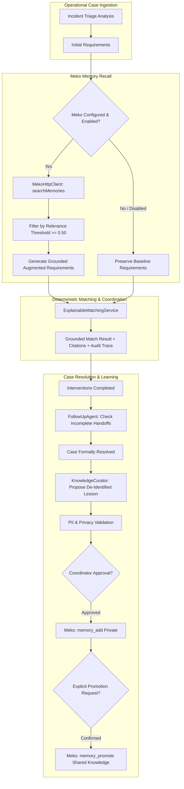

# UMEED — Phase 6.2B: Product Memory Agents Architecture & Orchestration

**Document Version**: 1.0.0  
**Evaluator**: Principal AI Agent Architect  
**Code Baseline**: `apps/web/src/features/context-learning/`  
**Target Meko Datapack**: `umeed-product-context`  

---

## 1. Executive Summary

Phase 6.2B introduces three specialized, typed product agents built on top of UMEED's core deterministic domain engine:

1. **`MatchingAgent` (`umeed_matching_agent`)**: Recalls approved operational context before running the explainable matching engine; injects grounded assistance requirements based on historical lessons without violating deterministic capability filters.
2. **`FollowUpAgent` (`umeed_followup_agent`)**: Analyzes unresolved case needs and completed interventions to recommend structured follow-up procedures (e.g. secondary dispatch, clinical admission checks, coordinator escalation).
3. **`KnowledgeCurator` (`umeed_curator_agent`)**: Proposes de-identified, reusable operational learnings from resolved cases, enforces strict PII scrubbing, and manages coordinator approval prior to memory creation and one-way knowledge promotion.

---

## 2. Agent Orchestration Architecture

---

## 3. Product Agent Contracts

### 3.1 Matching Agent (`MatchingAgent`)

- **Agent Identity**: `umeed_matching_agent`
- **Method**: `recallMatchingContext(incidentCategory, initialRequirements, options)`
- **Behavior**:
  - Issues hybrid search to Meko product datapack with query: `operational lessons for <category> assistance: <requirements>`.
  - Filters responses with relevance score below 0.50.
  - Pattern matches approved lessons (e.g. trauma animal rescue requiring veterinary inpatient admission).
  - Augments requirements vector while providing full citation evidence (memory ID, quote, reasoning, score).
  - Logs auditable trace to `contextTraceService`.
- **Method**: `executeGroundedMatching(params)`: Executes complete matching cycle and binds trace metadata for the UI Context Inspector.

### 3.2 Follow-Up Agent (`FollowUpAgent`)

- **Agent Identity**: `umeed_followup_agent`
- **Method**: `recallFollowUpProcedures(category, unresolvedNeeds, options)`
- **Behavior**:
  - Distinguishes advisory recommendations from verified requirements.
  - Evaluates recursive assistance stages to prevent premature case closure.
  - Emits recommendations with structured citations.

### 3.3 Knowledge Curator (`KnowledgeCurator`)

- **Agent Identity**: `umeed_curator_agent`
- **Methods**:
  - `proposeLessonFromCase(caseOutcome)`: Synthesizes a generalized, de-identified operational pattern.
  - `persistApprovedLesson(lesson, coordinatorId)`: Writes private memory via `memory_add`.
  - `confirmAndPromoteLesson(memoryId, coordinatorId, confirmationNotes)`: Executes one-way promotion via `memory_promote` after explicit human preview.

---

## 4. Privacy & PII Guardrails

All proposed memories and queries pass through `validateOperationalMemoryText`:

- **Scrubbed & Blocked Elements**: Emails, telephone numbers, Aadhaar/PAN formats, secret tracking tokens (`trk_*`), GPS decimal coordinates beyond city/district level.
- **Fail-Closed Policy**: If personal data is detected, the proposal is rejected immediately with a structured validation error before reaching any Meko MCP tool.
