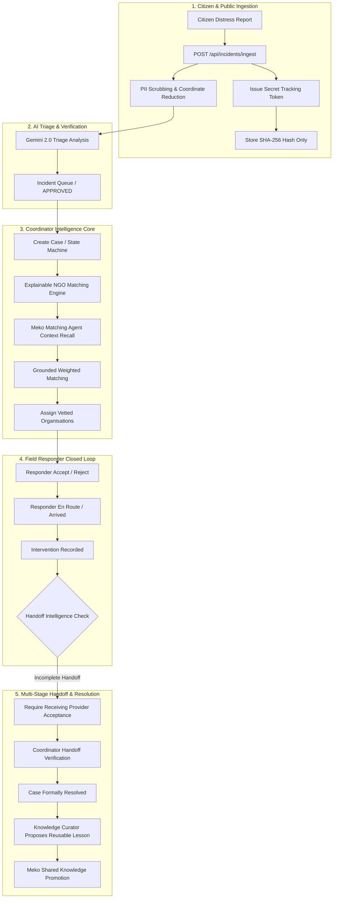
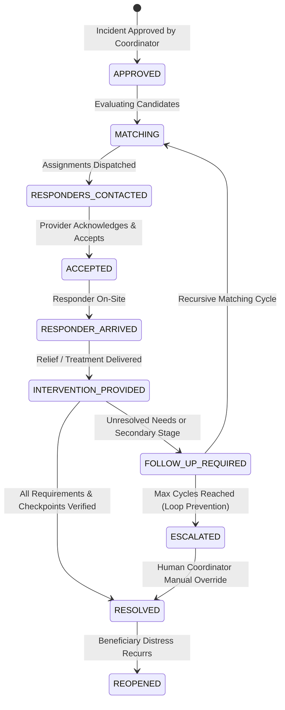
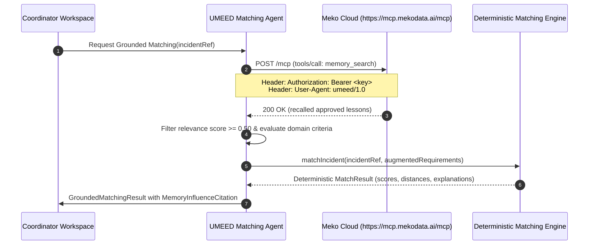

# UMEED — Project Release Architecture Specification

**Version**: Release Candidate 1.0 (RC-1)  
**Track**: HackCBS 9.0 | Meko Challenge Track A  
**System Classification**: Closed-Loop Assistance Coordination Platform  
**Target Environment**: Next.js 15 App Router, React 19, TypeScript 5.7, Node.js 20+  

---

## 1. System Overview & Core Philosophy

UMEED operates on a single core principle: **an incident is not resolved when an organisation accepts it, nor when a responder arrives, but only when verified assistance is confirmed and downstream handoff checkpoints are satisfied.**

The architecture is divided into three coordinated layers:
1. **Public Intake & Privacy Layer**: High-accessibility citizen reporting, PII redaction, GPS precision reduction, and confidential token hashing.
2. **Deterministic Domain Core**: State-machine governed cases, geodesic NGO matching, atomic multi-provider assignment, and immutable audit logs.
3. **Contextual Memory & AI Intelligence Layer**: Gemini multimodal triage and Meko Model Context Protocol (MCP) Streamable HTTP memory recall, citation, and promotion.

---

## 2. Shared Case Lifecycle State Machine

The core state machine governs both the overall case and individual provider assignments. Competing or duplicate state transitions are rejected with HTTP 400 Bad Request.

### 2.1 Explicit Distinction of Operational Milestones

To prevent premature case closure:
1. **Intervention Recorded**: A responder has submitted evidence of their specific on-site relief (e.g., street animal rescued and stabilized with splint). The assignment is marked `INTERVENTION_RECORDED`, but the case is NOT resolved.
2. **Handoff Verified**: If the case involves multi-stage care (e.g., veterinary surgical admission or shelter intake), downstream acceptance by the receiving institution is tracked via an independent `HandoffCheckpoint`.
3. **All Assistance Requirements Satisfied**: The mathematical set subtraction of `assistance_requirements - assistance_provided` must equal empty set, or the coordinator must provide an explicit override justification.
4. **Case Formally Resolved**: Only when steps 1, 2, and 3 are affirmatively confirmed can the case transition to `RESOLVED`.

---

## 3. Meko MCP Integration Architecture

UMEED interacts with Meko Cloud via the official Model Context Protocol (MCP) Streamable HTTP protocol specification (2024-11-05).

### 3.1 Datapack Isolation Policy
- **`umeed-build`**: Strictly reserved for engineering team technical decisions, architecture logs, and build-time multi-contributor Check T verification. It is NEVER accessed during runtime product operations.
- **`umeed-product-context`**: Dedicated solely to approved operational lessons, clinical coordination handoff precedents, and field rescue protocols.

---

## 4. Security & Data Tenancy Boundaries

| Boundary | Enforcement Mechanism | Failure Mode |
|---|---|---|
| **Coordinator Access** | `verifyCoordinatorAuth`: timing-safe comparison against configured `COORDINATOR_API_KEY` | 401 Unauthorized, zero case details returned |
| **Citizen Tracking** | `extractTrackingToken`: confidential `trk_...` token compared via SHA-256 hash | 404/401, tracking tokens never accepted in URL queries |
| **Responder Identity** | `verifyResponderAuth`: validated tenancy headers and authenticated bearer tokens | 401 Unauthorized; cannot act on foreign organisation assignments |
| **Memory Modification** | Server-side coordinator authorization + PII sanitization regex check | 401/400; unapproved text or raw PII rejected |
| **External Outage** | High-fidelity InMemory repositories and graceful fallback adapters | Continuous uptime with clear warning indicators |

