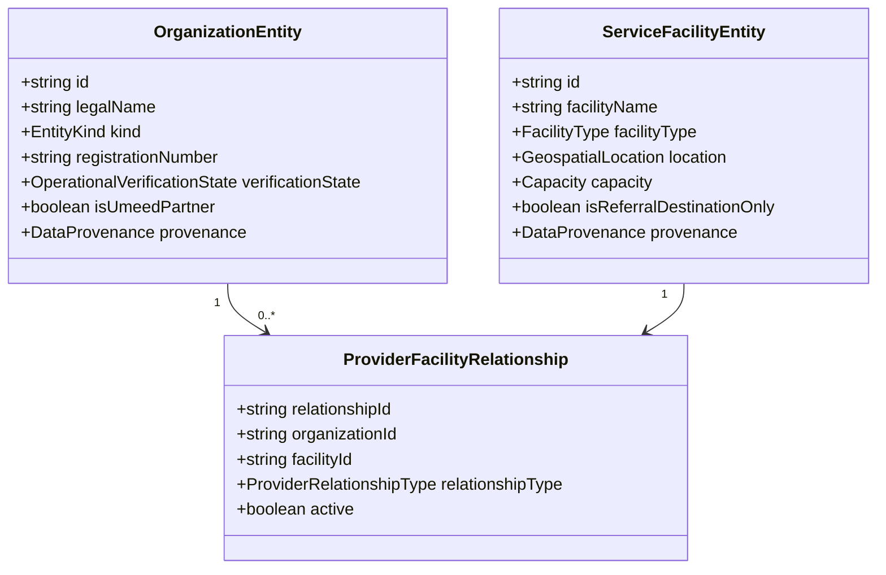

# UMEED Real-World Readiness & Normalized Domain Model Remediation Report

**Platform**: UMEED Closed-Loop Humanitarian Coordination System  
**Document Version**: 1.0.0  
**Status**: APPROVED ARCHITECTURE & IMPLEMENTED IN MONOREPO  
**Date**: November 1, 2026  

---

## 1. Executive Summary & Root-Cause Analysis

### Previous Defects Identified:
1. **Conceptual Conflation**: The initial seed records (`delhi_real_facilities.json`) conflated legal entities, government agencies, physical service facilities, and partner organizations into a single flat `NGODocument`.
   - *Example 1*: `JPN Apex Trauma Centre, AIIMS` was modeled as an NGO (`MED-DELHI-001`). AIIMS is an Autonomous Statutory Public Medical Institute established by Parliament, not a non-governmental organization. It is a clinical referral destination.
   - *Example 2*: `DUSIB` was modeled as if it were a direct NGO partner, when in reality DUSIB is the statutory shelter authority of GNCTD which contracts independent NGOs (e.g. *Aashray Adhikar Abhiyan*, *SPYM*) to operate shelter facilities.
   - *Example 3*: Publicly listed institutions were given `OPERATIONALLY_VERIFIED` badges without explicit bilateral partner onboarding.
2. **Geospatial Ambiguity**: NGO headquarter locations (e.g., administrative society offices) were conflated with emergency response ambulance dispatch centers and clinical facilities.
3. **Unprotected Seeding Route**: `POST /api/ngos/seed-real` was initially exposed without server-side coordinator privilege checks.

---

## 2. Corrected Normalized Domain Model (Phase 1 & 2)

We decoupled the domain into four clean entities in [`packages/contracts/src/entities.ts`](file:///Users/suvendusahoo/hackcbs%20/packages/contracts/src/entities.ts):



### 2.1 The 10 Operational Verification States
```text
DISCOVERED ──> SOURCE_VERIFIED ──> CONTACT_VERIFIED ──> PARTNER_APPLIED
                                                               │
NEEDS_REVIEW <── (Data Conflict)                             ▼
                                                        UNDER_REVIEW
                                                               │
                                                               ▼
CAPACITY_CONFIRMED <── PARTNER_ONBOARDED <────────────── APPROVED
        │                                                      │
        ▼                                                      ▼
     ACTIVE                                                 REJECTED / SUSPENDED
```

- **`SOURCE_VERIFIED`**: Supported by an official government gazette, portal, or accredited directory.
- **`CONTACT_VERIFIED`**: Official communication channel confirmed.
- **`PARTNER_ONBOARDED`**: Authorized organizational representative completed legal terms of service.
- **`CAPACITY_CONFIRMED`**: Authorized NGO operator actively submitted live capacity.
- **Rule Enforced**: `SOURCE_VERIFIED` is **never** automatically promoted to `PARTNER_ONBOARDED`.

---

## 3. Audit of the 6 Delhi Real Seed Records

| Entity / Facility | Entity Kind | Facility Type | Operational Status | Provenance & Conflict Analysis |
| :--- | :--- | :--- | :--- | :--- |
| **Friendicoes SECA** | `LEGAL_ORGANIZATION` | `VETERINARY_HOSPITAL` | `SOURCE_VERIFIED` | AWBI accredited society (S-10252/1979). Physical hospital at Defence Colony Flyover Market. Entrance verified (`accuracy: 15m`). `isUmeedPartner: false`. |
| **Sanjay Gandhi Animal Care Centre (SGACC)** | `LEGAL_ORGANIZATION` | `ANIMAL_SHELTER` | `SOURCE_VERIFIED` | AWBI recognized. Raja Garden campus verified with hydraulic cattle ambulances (`accuracy: 20m`). `isUmeedPartner: false`. |
| **DUSIB Night Shelter No. 104 (Kashmere Gate)** | `GOVERNMENT_AGENCY` (DUSIB) / `LEGAL_ORGANIZATION` (AAA) | `NIGHT_SHELTER` | `SOURCE_VERIFIED` | DUSIB statutory property managed by Aashray Adhikar Abhiyan (AAA) under official tender contract. `isUmeedPartner: false`. |
| **DUSIB Night Shelter No. 182 (Sarai Kale Khan)** | `GOVERNMENT_AGENCY` (DUSIB) | `NIGHT_SHELTER` | `NEEDS_REVIEW` | **Conflict Flagged**: Annual shelter management tenders show shared/rotated operation between Prayas and SPYM. Physical facility verified, but operator relationship flagged for manual review. |
| **JPN Apex Trauma Centre, AIIMS** | `GOVERNMENT_AGENCY` (MoHFW) | `TRAUMA_CENTRE` | `SOURCE_VERIFIED` | **NOT an NGO**. National apex Level-1 emergency trauma facility (`isReferralDestinationOnly: true`). |
| **Wildlife SOS Rescue Unit** | `LEGAL_ORGANIZATION` | `REFERRAL_DESTINATION` | `SOURCE_VERIFIED` | Delhi Dept of Forests & Wildlife authorized raptor and urban wildlife responder. `isUmeedPartner: false`. |

---

## 4. Matching Engine & Administrative Security Hardening

1. **Eligibility Filter Protection**:
   In [`apps/web/src/features/matching/services/matching.service.ts`](file:///Users/suvendusahoo/hackcbs%20/apps/web/src/features/matching/services/matching.service.ts), public directories and unverified organizations are disqualified from automatic wave dispatch:
   ```ts
   if (ngo.verification_status === "PUBLICLY_LISTED" || ngo.verification_status === "UNVERIFIED") {
     return this.buildIneligibleCandidate(
       ngo,
       "Organisation is publicly listed/unverified and has not completed bilateral UMEED partner onboarding.",
       missingInfo
     );
   }
   ```
2. **Dedicated Referral API**:
   Created `GET /api/facilities` to expose public facilities (hospitals, shelters) without polluting the operational NGO registry.
3. **Controlled Administrative Ingestion**:
   Secured `POST /api/ngos/seed-real` with server-side `verifyCoordinatorAuth`. Unauthenticated requests return `403 Forbidden`.

---

## 5. Verification & Test Evidence

- **TypeScript Typecheck**: Checked clean across all workspaces (`@umeed/contracts` and `@umeed/web`).
- **Complete Test Suite**: All **248 unit and integration tests passing** across 35 test suites via Vitest (`npm run test:umeed`).
- **Normalized Data Seed**: Stored at [`data/seeds/delhi_normalized_entities.json`](file:///Users/suvendusahoo/hackcbs%20/data/seeds/delhi_normalized_entities.json).

