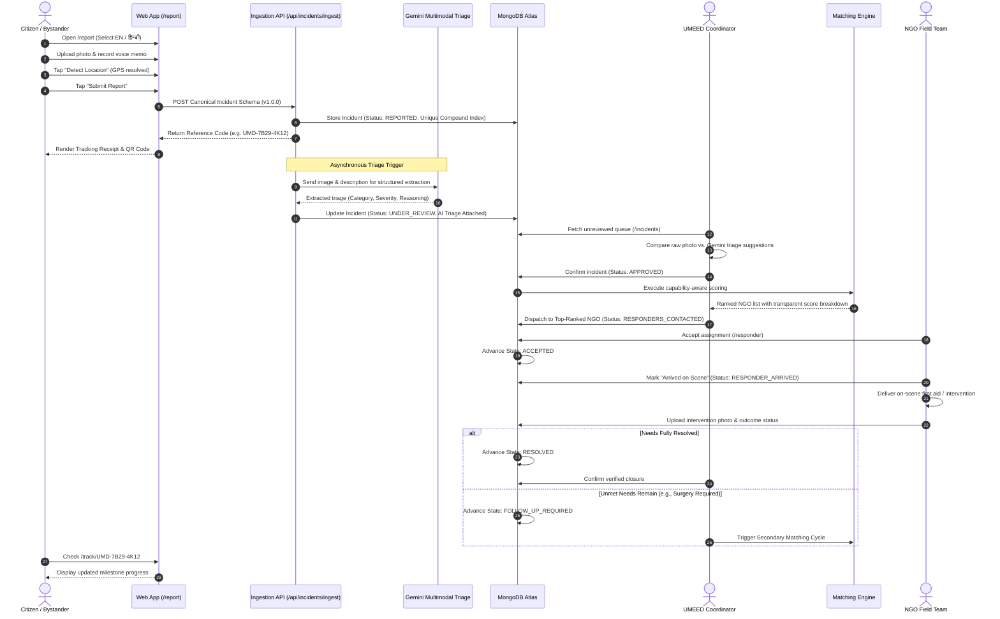
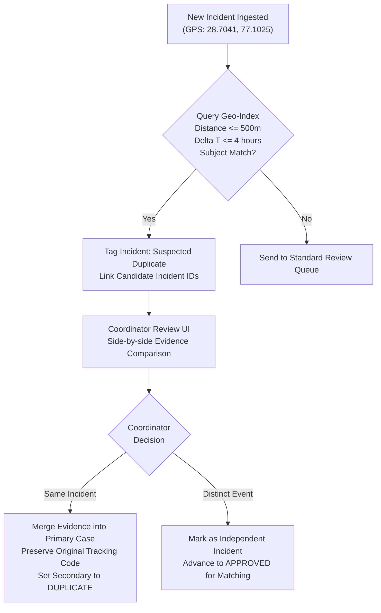
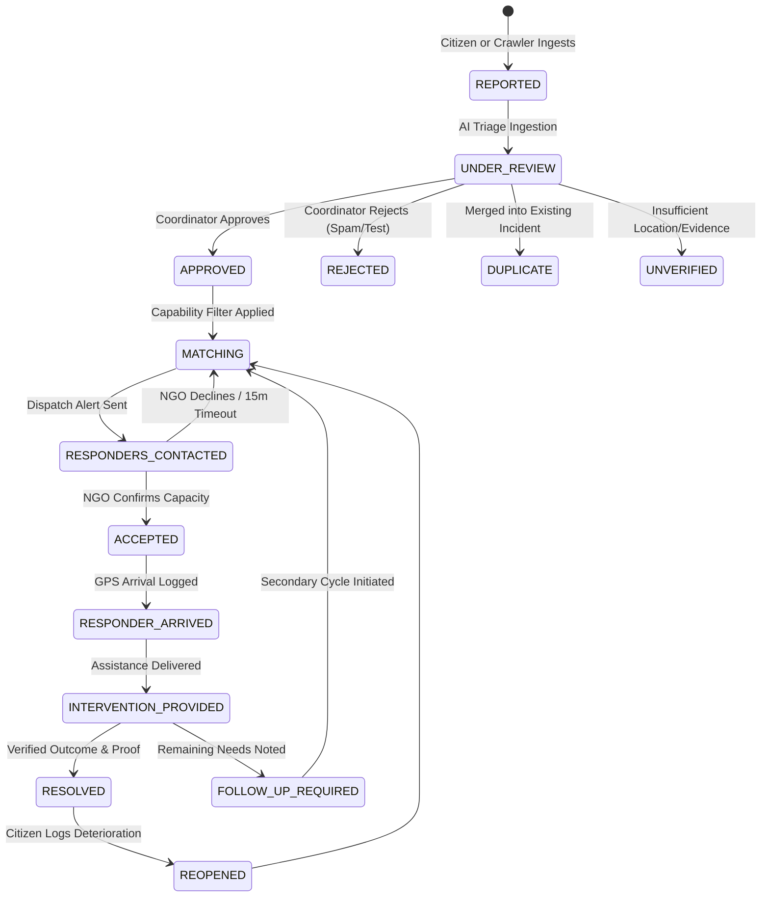

# UMEED User Journeys & Interaction Architecture

**System**: UMEED (Closed-Loop Social Distress Assistance Platform)  
**Hackathon**: HackCBS 9.0  
**Authors**: Senior Open Source Maintainer, Staff Product Engineer, Enterprise UX Architect  
**Status**: Specification & Architectural Baseline  

---

## 1. Information Architecture & Navigation Hierarchy

```
UMEED Platform Architecture
├── 1. Public Citizen Portal (Unauthenticated)
│   ├── / (Overview / Hero CTA / Status Lookup)
│   ├── /report (Citizen Distress Submission)
│   │   ├── Step 1: Media Capture & Audio Transcription
│   │   ├── Step 2: Geolocation & Landmark Entry
│   │   └── Step 3: Distress Categorization & Anonymous Toggle
│   └── /track/[referenceCode] (Milestone Progress & Follow-up Submission)
│
├── 2. Operations & Coordinator Workspace (Role: COORDINATOR)
│   ├── /incidents (Triage Queue & Freshness Monitor)
│   │   ├── Tab: Pending Review
│   │   ├── Tab: Suspected Duplicates
│   │   └── Tab: Escalated High-Risk
│   ├── /incidents/[id] (Side-by-Side Review & Triage Verification)
│   ├── /cases (Active Case Coordination Board)
│   │   ├── Kanban: Matching → Dispatched → Arrived → Intervention
│   │   └── Filter: By District, By Need Type, By Urgency
│   └── /cases/[id] (Lifecycle State Machine, Timeline & Secondary Cycle Initiation)
│
├── 3. NGO Responder Portal (Role: NGO_RESPONDER / NGO_ADMIN)
│   ├── /responder (Active Assignments & Capacity Dashboard)
│   ├── /responder/cases/[caseId] (Assignment Details, Navigation & On-Scene Verification)
│   └── /ngos/manage (Organization Profile, Capabilities & District Bounds)
│
├── 4. Governance & Insights Console (Role: PLATFORM_ADMIN)
│   ├── /admin (System Status, Outbox Latency & Integration Health)
│   ├── /admin/ngos/verification (NGO DARPAN & Accreditation Verification)
│   ├── /admin/audit (Immutable Audit Trail Explorer)
│   └── /analytics (Historical Telemetry & Unmet Need Patterns)
```

---

## 2. End-to-End User Journey Diagrams

### Journey 1: Citizen Distress Reporting to Verified Resolution



---

### Journey 2: Potential Duplicate Identification & Resolution



---

## 3. Case Coordination State Machine Visualisation



---

## 4. Page-Level Component Inventory

### Page 1: Citizen Distress Report (`/report`)
| Component | Purpose & Accessibility Specification |
|---|---|
| `LanguageSelector` | Toggle between English and Hindi. Keyboard navigable, sets `aria-label="Language selection"`. |
| `MediaUploadDropzone` | Drag-and-drop or camera shutter trigger. Supports camera capture on mobile. Screen-reader file size validator. |
| `AudioTranscriber` | One-touch audio record button with pulse animation. Streams speech recognition to description box. |
| `GeoLocationPicker` | GPS button: "Use Current Location" (`aria-busy` during resolution). Displays interactive street name fallback. |
| `CategoryChipGroup` | Radio button group styled as touch-friendly cards (min 48px height) with icons for injured animals, homeless welfare, etc. |
| `AnonymousToggle` | Checkbox toggling privacy mode. Explains: "No contact info saved or shared." |
| `SubmitButton` | High-contrast button with loading spinner, disabled state, and accessible live error messages. |

### Page 2: Citizen Progress Tracker (`/track/[referenceCode]`)
| Component | Purpose & Accessibility Specification |
|---|---|
| `ReferenceCodeHeader` | Prominently displays code with copy-to-clipboard button and SVG status icon. |
| `MilestoneProgressBar` | 4-step vertical or horizontal stepper with clear text labels and completion timestamps. |
| `PrivacyNoticeCard` | Explains location redaction policy: "Exact location concealed for beneficiary protection." |
| `FollowUpEvidenceForm` | Collapsible accordion allowing reporter to append notes or photos if situation evolves. |
| `EmergencyBanner` | Contact details for 112 / 102 for life-or-death situations. |

### Page 3: Coordinator Incident Review (`/incidents/[id]`)
| Component | Purpose & Accessibility Specification |
|---|---|
| `IncidentHeaderBar` | Severity badge, elapsed age counter, and quick action bar. |
| `EvidenceGallery` | Lightbox with pan/zoom for high-res wound/condition inspection and EXIF timestamp verification. |
| `AITriageSummaryPanel` | Structured Gemini output breakdown: subject, observed trauma, urgency score, and missing info flags. |
| `DuplicateAlertBanner` | Visual comparison card showing proximity, time delta, and one-click merge action. |
| `TriageDecisionButtonGroup` | Keyboard-accessible action bar: `[Approve]`, `[Reject]`, `[Mark Duplicate]`, `[Request Info]`. |

### Page 4: Closed-Loop Case Coordination (`/cases/[id]`)
| Page Component | Purpose & Accessibility Specification |
|---|---|
| `StateBadge` | Clear high-contrast badge indicating current state in the lifecycle. |
| `ExplainableMatchingCard` | List of NGOs sorted by match score with expandable mathematical explanation. |
| `DispatchActionBar` | Action button: "Assign Case to [NGO Name]" with timeout counter. |
| `ImmutableAuditTimeline` | Reverse-chronological feed of all state changes, timestamps, and actor IDs. |
| `RecursiveCycleTrigger` | Action button: "Initiate Secondary Assistance Cycle" with multi-select unmet need checklist. |

### Page 5: NGO Responder View (`/responder/cases/[caseId]`)
| Component | Purpose & Accessibility Specification |
|---|---|
| `AssignmentBriefCard` | Big-font summary: Subject, distance, primary required capability, urgency. |
| `NavigationDeepLink` | Deep link to Google Maps / OpenStreetMap turn-by-turn navigation. |
| `StateTransitionControl` | Prominent primary button: "Mark En Route", "Mark Arrived", "Submit Intervention". |
| `InterventionForm` | Form requiring intervention category, photo upload of outcome, and resolved vs. follow-up required toggle. |

---

## 5. Responsive Layout Specifications

| Breakpoint | Target Screen Width | Layout & Navigation Adaptations |
|---|---|---|
| **Mobile (`sm`)** | `< 640px` | Single-column linear layout. Sticky bottom action bar for primary CTA. Bottom navigation drawer replaces sidebar. Camera capture directly invokes device camera. |
| **Tablet (`md`)** | `640px - 1024px` | Two-column grid where appropriate. Collapsible sidebar navigation. Incident review switches to stacked panels with tab switching. |
| **Desktop (`lg` / `xl`)** | `> 1024px` | Persistent left sidebar (240px). Side-by-side comparison panels (Evidence on Left 55%, AI Triage & Matching on Right 45%). Split-screen interactive map and table views. |

---

## 6. Offline & Low-Bandwidth Handling Strategy

To ensure dependable operations in field conditions with spotty 2G/3G connectivity across Delhi NCR:
1. **Aggressive Image Optimization**: Client-side canvas compression downscales evidence photos to maximum 1600px width and WebP format before network transmission.
2. **IndexedDB Local Storage Queue**: When `navigator.onLine === false`, the citizen report form saves serialized data to IndexedDB. An ambient notification alerts the user: *"Network unavailable. Your report is saved locally and will upload automatically once reconnected."*
3. **Optimistic State Updates**: NGO responder status toggles update the local UI immediately, enqueueing background sync requests with retry backoff.
