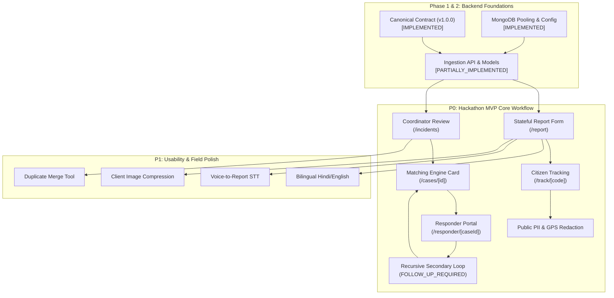

# UMEED UX & Operational Gap Analysis with Prioritization Matrix

**System**: UMEED (Closed-Loop Social Distress Assistance Platform)  
**Hackathon**: HackCBS 9.0  
**Authors**: Staff Product Engineer, Enterprise UX Architect, Accessibility Engineer  
**Status**: Strategic Prioritization Baseline  

---

## 1. Prioritization Framework

To maximize hackathon impact while maintaining strict engineering rigor, every UX enhancement and product capability is categorized:

- **`P0` (Hackathon MVP Core)**: Essential for the end-to-end evaluation journey (Intake → Triage → Verification → Matching → First-Aid → Recursive Secondary Match → Resolved).
- **`P1` (Post-Core Enhancements)**: Enhances field usability, bilingual reach, and operational depth; activated immediately after core workflow stability.
- **`P2` (Long-Term Roadmap)**: Enterprise scalability, advanced audio ingestion, and broad automated crawler discovery.

---

## 2. Comprehensive UX Gap Analysis & Prioritization Matrix

| Feature / UX Component | Target Persona | Priority | Complexity | Upstream Dependencies | Operational Impact |
| --- | --- | --- | --- | --- | --- |
| **Stateful Citizen Report Form (`/report`)** | Citizen | **P0** | Medium | Canonical Incident Schema (`packages/contracts`) | Replaces static placeholder with interactive photo upload, GPS resolution, and distress categories. |
| **Reference Code Generator & Receipt (`UMD-XXXX-YYYY`)** | Citizen | **P0** | Low | Ingestion API (`POST /api/incidents/ingest`) | Provides the reporting bystander with an immediate, shareable tracking token. |
| **Citizen Milestone Tracking Screen (`/track/[code]`)** | Citizen | **P0** | Medium | Case State Machine & Tracking Query API | Allows citizens to see progress without exposing responder or beneficiary PII. |
| **Coordinator Triage Review Queue (`/incidents`)** | Coordinator | **P0** | Medium | Ingestion API & Incident Data Model | Allows coordinators to view unreviewed incidents sorted by urgency and age. |
| **Interactive Gemini Triage Verification Panel** | Coordinator | **P0** | Medium | Gemini API Adapter & Review Action API | Presents Gemini multimodal suggestions alongside raw photo with one-tap Approve/Reject. |
| **Explainable NGO Matching Card** | Coordinator | **P0** | Medium | NGO Registry & Matching Formula Engine | Shows scored ranking with transparent capability filter and proximity score. |
| **Closed-Loop NGO Responder Portal (`/responder/[caseId]`)** | NGO Responder | **P0** | High | Case State Machine (`case_events`) | Enables field teams to Accept, Mark En Route, Mark Arrived, and Upload on-scene outcome. |
| **Recursive Assistance Trigger (`FOLLOW_UP_REQUIRED`)** | Coordinator / NGO | **P0** | High | State Machine & Matching Engine | Enables two-cycle assistance where incomplete field care triggers secondary specialized matching. |
| **Public GPS Redaction & PII Scrubbing Serializer** | Public / Citizen | **P0** | Low | Core Security Module (`apps/web/src/lib/security`) | Guarantees exact beneficiary GPS coordinates are never sent to unauthenticated clients. |
| **Bilingual Toggle (English / हिन्दी)** | Citizen | **P1** | Low | Citizen Report Form | Expands accessibility to non-English speaking citizens across Delhi NCR. |
| **Duplicate Candidate Comparison & Merge Tool** | Coordinator | **P1** | Medium | Spatial Indexing & Geospatial Proximity Query | Prevents multiple responders from being dispatched to the same injured animal or person. |
| **Follow-Up Evidence Submission Accordion** | Citizen | **P1** | Medium | Tracking Screen & Upload API | Lets citizens append newer photos if subject condition or location changes. |
| **Low-Bandwidth Image Compression (Canvas WebP)** | Citizen / NGO | **P1** | Low | Form Dropzone | Prevents network timeouts on slow 2G/3G mobile networks. |
| **Voice-to-Report Audio Transcription (Web Speech API)** | Citizen | **P1** | Medium | Browser Web Speech API (`hi-IN` / `en-IN`) | Enables distressed or illiterate bystanders to speak descriptions naturally. |
| **NGO Capacity & Availability Toggle** | NGO Admin | **P1** | Low | NGO Data Model | Lets NGOs mark themselves `Busy` or `Off Duty` to prevent stalled dispatches. |
| **Admin NGO DARPAN Verification Governance** | Administrator | **P1** | Medium | Admin API & NGO Registry | Authorizes organizations into `operationally_verified` dispatch tiers. |
| **Offline IndexedDB Queue for Field Submissions** | Citizen / NGO | **P2** | High | Service Worker & Local Storage Adapter | Stores submissions locally when offline and syncs upon reconnection. |
| **Meko Persistent Coordination Memory Panel** | Coordinator | **P2** | Medium | Meko MCP Server & Datapack Configuration | Remembers coordinator dispatch preferences across recurring sessions. |
| **IOMETE Iceberg Telemetry Dashboard (`/analytics`)** | Administrator | **P2** | Medium | Integration Outbox Worker & IOMETE Client | Visualizes macro district trends, recurring distress hotspots, and response lag. |
| **Social Distress Discovery Crawler (`services/discovery`)** | System | **P2** | High | FastAPI, FFmpeg, and Multimodal Vision Model | Automatically ingests public distress media from social channels. |

---

## 3. Dependency Graph & Critical Path

---

## 4. Key UX Gaps & Recommended Solutions

### Gap 1: Citizen Form Missing Real-Time Geolocation Feedback

- **Problem**: Bystanders on the street do not know their precise street address; manual typing causes drop-off.
- **Solution**: Implement one-touch "Detect My Location" using `navigator.geolocation`, with instant reverse-geocoding into human-readable landmarks and district name, while retaining an editable fallback.

### Gap 2: Missing Reassurance During Upload & AI Triage

- **Problem**: Multimodal AI processing and image uploads take 2–4 seconds; users may re-click or assume failure.
- **Solution**: Render an accessible, multi-phase progress indicator: *"Uploading photo (1/2) → Verifying coordinates (2/2) → Submitting to UMEED coordination network..."* with `aria-live="polite"`.

### Gap 3: Coordinator Cognitive Overload During Multi-Incident Spikes

- **Problem**: Reviewing 20+ distress reports sequentially leads to decision fatigue.
- **Solution**: Highlight extracted key evidence (trauma flags, vulnerable subject status, traffic danger) in high-contrast visual chips, allowing coordinators to triage critical life-safety incidents in under 15 seconds.

### Gap 4: Disconnected Post-Intervention Care

- **Problem**: In existing NGO dispatch systems, once a responder visits, the case is marked closed even if the subject still requires surgery or ongoing shelter.
- **Solution**: Mandate an outcome gate on the responder portal (`Intervention Outcome: [Fully Resolved] vs [Follow-up Required]`). If follow-up is checked, the system automatically opens a secondary assistance cycle.
